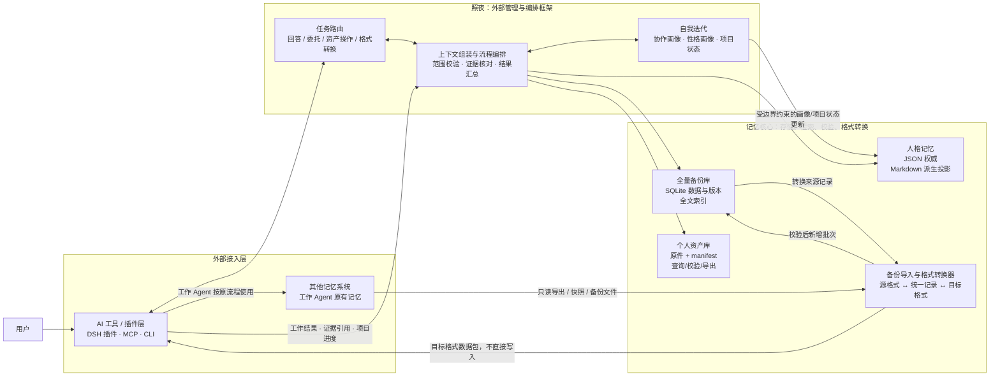
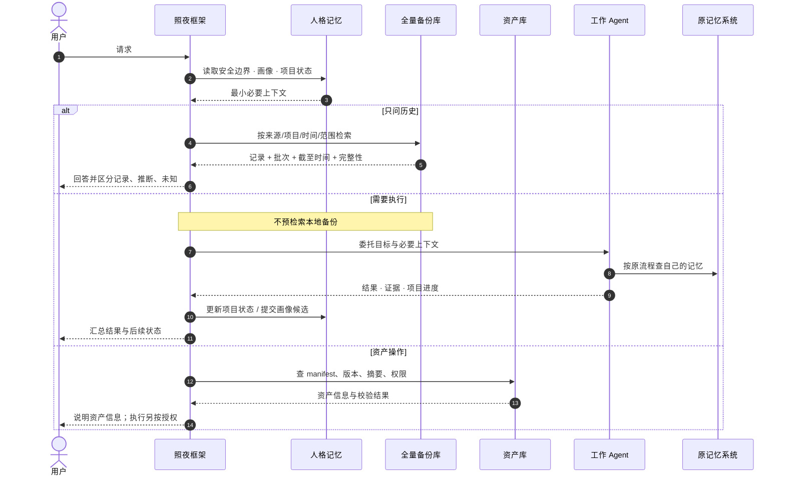

# 01 架构基线

> **状态**：当前架构基线（2026-10-30）。
> **替代**：`外部管理框架与记忆核心设计.md` 与 `记忆核心架构总结.md`（已并入本文）。
> **读法**：本文只写“是什么、边界在哪、什么不能变”。接口与字段见 [03-记忆核心技术设计](03-记忆核心技术设计.md)，落地顺序见 [02-工程与里程碑](02-工程与里程碑.md)。

## 1. 定位

照夜（zhaoye）是**外部管理与编排框架**：它调用外部 AI 工具/模型完成理解、对话与认知任务，管理三类严格隔离的本地数据域，并把“该谁检索记忆”这件事定死。

一句话：**插件是门，`~/.zhaoye` 是身体；换工具还是同一个助理。**

不做的事：

- 不实现、不接管工作 Agent 正在使用的记忆系统；不向其写入、修改、删除记忆，也不调用它的在线查询接口。
- 不要求全局追加日志或 hash 链作为事实源；不把照夜整理出的结论回写任何外部系统。
- 不把认知算法塞进存储层：存什么、值不值得记由外部框架和模型判断，存储只负责忠实存取。

## 2. 架构总览



转换器只做结构与字段映射，不做语义蒸馏或事实裁决。照夜可以生成供目标系统导入的数据包，但写入目标系统由对应工具或工作 Agent 按自己的流程完成。

## 3. 三个数据域

三域各有权威格式、访问接口、生命周期和权限。跨域只传稳定 ID、证据引用和最少必要结果，不复制原件，不把某域的摘要冒充另一域的事实。

| 数据域 | 权威存储 | 保存内容 | 主助手用途 |
|---|---|---|---|
| 助手人格记忆 | JSON；Markdown 为派生投影 | 安全内核、协作画像、性格画像、项目状态、连续性摘要 | 形成一致的身份、语气与关系连续性 |
| 全量记忆库 | SQLite（本地副本） | 从外部记忆系统只读导出、转换并备份的完整数据与版本 | 回答历史问题、提供工作证据 |
| 个人资产库 | 文件夹 + manifest + 对外脚本 | skill、文档、代码包、配置、模型等原件与清单 | 定位、校验、导出、授权后交给执行器 |

### 3.1 助手人格记忆

JSON 是唯一权威数据；Markdown 由 JSON 渲染，供提示装配和人工查看，**禁止 Markdown 反向覆盖 JSON**。

人格 JSON 区分五段，避免把安全边界、用户偏好和工作知识混在一起：

| 段 | 内容 | 谁能改 |
|---|---|---|
| `safety_kernel` | 少量稳定行为边界（不擅自主张、不主动改用户资产或偏好等） | **只有用户明确发起**的专门流程；模型、导入、蒸馏都不能改 |
| `user_profile` | 用户的协作偏好、沟通习惯、明确事实 | 可依据证据迭代；用户纠错优先于推断 |
| `character_profile` | 照夜自己的性格、表达风格、行为倾向 | 可在内核边界内迭代，保留来源、证据、置信度、版本与回滚 |
| `project_state` | 项目目标、已确认决策、进度、风险、阻塞项、下一步 | 依据用户对话与 Agent 返回更新，记来源与时间 |
| `continuity_memory` | 精选的共同经历摘要，用于自然衔接对话 | 由框架维护；只是摘要，不替代备份证据 |

**不进入人格自迭代的内容**：技术踩坑、排障步骤、命令、环境差异、代码经验和 Agent 的操作习惯。这些属于工作 Agent 的原记忆系统；照夜可以接收其任务结果与项目进度，但不吸收其技术经验。

无论画像如何演化，都不能扩大工具权限或突破安全内核。

### 3.2 全量记忆备份库

SQLite 是外部记忆数据的**本地备份与查询副本**。工作 Agent 继续访问原系统，主助手查询本地副本；照夜不通过该库写回，也不依赖原系统的在线检索能力。

```text
只读导出/备份获取 → 保留源文件 → 转换与校验 → SQLite 入库 → 建立全文索引
```

每条导入记录至少保留：来源系统、源记录 ID、来源 Agent/项目范围、源更新时间、导出批次、转换器版本、内容摘要、备份版本、可见/删除状态。转换可重复执行；相同来源记录与版本重复导入幂等；新版本不静默覆盖旧备份；源端删除或不可见表达为显式状态。

SQLite 事务负责本地原子更新。备份版本表服务于恢复与来源追踪，不等于全系统事件溯源。

### 3.3 个人资产库

文件夹保存原件；每项资产有稳定 ID 与 manifest，记录类型、名称、版本、来源、文件清单、SHA-256、依赖、所需权限与入口说明。

**检索、校验、执行是三件事**：找到 skill 不代表已授权运行。执行器在运行前必须验证来源、版本、摘要、权限和用户当前请求；执行结果作为照夜自己的操作记录保存，不改写外部记忆备份。

## 4. 只读备份边界

- 允许：读取用户授权的备份文件、只读导出、快照或只读备份接口。
- 允许：转换为本地 SQLite 格式、建本地索引、保留备份版本。
- 不允许：调用外部系统的记忆查询/写入/编辑/删除工具；不把照夜的整理结果回写原系统。
- 工作 Agent 用原系统、主助手用本地副本，两者一致性由备份刷新周期决定，**不宣称实时同步**。

每次备份必须显示来源与截至时间。未完成、部分可见、转换失败或源端不可达时，记录批次状态并提示降低结论确定性。**只有确认批次完整，才能标为全量快照；部分导入不得覆盖上一个完整快照。**

## 5. 任务路由与检索责任

首要判断是“基于已有记录回答”还是“委托执行”。**一项任务只由一个责任方检索工作记忆**，避免同一任务双查。



路由规则：

1. **记忆问答**：只问历史事实/经验，且本地备份足以回答时，由照夜查 SQLite；答案附来源、批次、截至时间、完整性。
2. **工作委托**：检查、开发、安装、排障、运行、验证，直接委托工作 Agent，按其原流程访问原记忆系统；照夜不重复查备份。
3. **资产操作**：先查资产库并校验版本、摘要、来源、权限；查到不等于授权执行。
4. **确有缺口时**：Agent 明确缺少某条备份信息，框架才按需补查，交付带引用的最小必要信息。
5. **混合请求**：以主要目标分流；必要时先答历史部分再委托执行，但两条路径不默认各查一遍。

## 6. 模块职责

| 模块 | 负责 | 不负责 |
|---|---|---|
| AI 工具/插件层 | 模型推理、对话、工作 Agent、执行器；返回结构化结果 | 决定数据权限边界；把模型输出自动当事实 |
| 外部框架 | 识别目标、路由、选择范围、组装上下文、校验证据、汇总结果、管理授权与项目状态 | 实现底层存储；把 Agent 技术经验写进人格 |
| 人格记忆存储 | 校验并保存 JSON、生成 Markdown 投影、受控更新与回滚 | 自行判断画像该不该变；让模型绕过内核 |
| SQLite 备份库 | 保存导入版本与记录、维护索引与来源、只读查询 | 接管原系统；对工作任务预检索；向任何系统写回 |
| 导入/转换适配器 | 解析源格式、映射结构、校验结果、生成目标格式数据包 | 语义分析、经验判断、直接操作目标系统 |
| 资产库 | 原件与 manifest、查询、校验、导出、授权后的执行入口 | 因被检索到就默认安装或运行 |
| 工作 Agent | 按原流程完成受托工作并查自己的记忆 | 修改照夜内核或未经确认改用户画像 |
| 原记忆系统 | 继续服务工作 Agent；按授权提供备份/导出 | 被照夜接管或后台写入 |

包与目录的对应关系、依赖规则见 [02-工程与里程碑](02-工程与里程碑.md)。

## 7. 不变量

改代码前先服从这些句子；任何一条要改，先立 ADR。

| ID | 不变量 | 可证伪的验收 |
|---|---|---|
| **I1** | **三域分离，权威格式唯一**：人格 JSON、备份 SQLite、资产原件各自权威；跨域只传 ID 与证据引用 | 越权/越域查询被拒绝；某域摘要不会被当作另一域事实返回 |
| **I2** | **单一写者 + 显式并发协议**：同一数据根同时只有一个活跃实例；写入以 `operation_id` 幂等、`expected_revision` CAS | 第二进程 open 得到带 owner 的错误；陈旧 revision 提交得到 `CONFLICT` 且文件未变；重复 `operation_id` 返回原回执 |
| **I3** | **派生数据可重建、不可反写**：Markdown 投影、全文索引、路由索引都是派生物，删掉能重建 | 删除投影后重建逐字节一致；手工改投影不影响读取结果 |
| **I4** | **安全内核不可被自主迭代**：仅用户明确发起的流程可改；模型、导入、蒸馏均不可 | 无用户确认的内核提交被拒；内核变更留版本、可回滚 |
| **I5** | **备份只读、来源可追溯**：导入只追加批次/版本，不覆盖完整快照，不写回源系统 | 重复导入幂等；部分批次不能标全量；源端删除表达为显式状态 |
| **I6** | **诚实覆盖**：结果区分 `complete` / `partial`，截断必须给游标；过期/不完整显式降级 | 10 条命中 limit=5 → `partial` + 游标；无更多 → `complete` |
| **I7** | **不静默失败、不静默成功**：错误必须带 `code` + `retry` + `action`；损坏与越权不得伪装成空结果 | 每个错误码都有可执行建议；失败注入断言没有“成功”返回值 |
| **I8** | **一扇门一次**：presence 定义进入/离开/崩溃/接管；活进程永不被自动抢占 | 崩溃、PID 死亡、心跳过期三条恢复路径各有测试；活锁拒绝强制接管 |
| **I9** | **端口化与依赖方向**：宿主、模型、执行器、外部源都是端口；core 不碰文件系统、只依赖 contracts；app 是唯一门面与组合根，负责构造具体存储 | dependency-cruiser 拦截越层与跨包 internal 导入 |
| **I10** | **预算一等公民**：注入与上下文上限只在一处定义、一处断言 | 超限必然在发送模型前失败；改预算必须同时改测试 |

与 2026-10-26 草案的差异：旧 I2“日志是唯一事实源、投影可重放”被 I3 + ADR 0002 取代；旧 I1 中的“单一提交序列”由 I2 的幂等 + CAS 承接；其余不变量保留原编号语义。

## 8. 与历史草案的关系

[架构设计 v2 历史草案](归档/架构设计-v2历史草案.md) 中的全局 journal、hash 链、统一提交序列器、投影重放、自建统一记忆查询属于已被取代的技术方案，见 [ADR 0002](决策记录/0002-以SQLite备份库替代全局事件日志.md)。其中仍然有效的部分已并入本文与 02/03：分层与依赖方向、错误模型、适配器能力矩阵、conformance 要求、预算清单。
