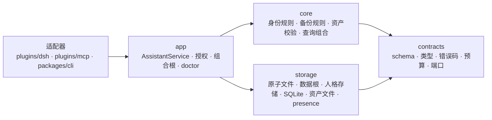

# 03 记忆核心技术设计

> **状态**：实现规格基线（2026-10-30）。
> **依据**：[01-架构基线](01-架构基线.md)。**落地顺序**：[02-工程与里程碑](02-工程与里程碑.md)。**M1 细节**：[04](04-M1-契约与人格记忆开发设计.md)。
> 本文定义契约、数据模型、端口、流程与验收；不重复论证“为什么要有三域”。

## 1. 范围与角色

记忆核心为照夜提供三类隔离数据域的本地存取、校验、检索和版本能力：

1. **人格记忆**：安全内核、协作画像、性格画像、项目状态、连续性摘要；JSON 权威，Markdown 派生。
2. **全量备份库**：外部记忆系统只读导出的本地 SQLite 副本与查询能力。
3. **个人资产目录**：原件 + manifest；核心只负责发现、校验与只读读取，不负责执行。

核心**不**调用模型、不判断内容是否值得记、不编排 Agent、不写回外部系统。认知框架提出候选，`app` 负责授权、校验与调用存储端口；用户当前请求、宿主策略与显式授权决定范围，导入本身不扩大权限。

## 2. 组件与依赖



- `contracts`：版本化 schema、错误码、预算、端口接口（含存储端口）与纯数据默认值；禁止 `node:*`。
- `storage`：实现存储端口，是唯一接触文件系统与 SQLite 的层；负责格式校验、原子性、并发串行、事务与索引。
- `core`：领域规则与查询组合；只依赖 `contracts`，不碰文件系统，不决定“值不值得记”。
- `app`：唯一业务门面与组合根；授权、范围、预算、幂等、生命周期、跨域步骤，并负责构造具体存储实现。
- 适配器：只把宿主工具映射到 `app` API。

依赖方向 `contracts ← (storage ∥ core) ← app ← adapters`；`core` 只认存储端口接口，不 import `storage` 实现。跨域流程由 `app` 按步骤协调，不假设 JSON、SQLite 和文件系统之间有跨存储事务。

## 3. 数据契约

### 3.1 人格记忆 JSON（schema_version 1）

`identity/identity.json` 是唯一权威数据，字段如下（zod schema 落在 `packages/contracts/src/identity.ts`）：

```ts
interface IdentityDocument {
  schema_version: 1;
  assistant_id: string;          // uuid
  revision: number;              // 全局整数，每次成功提交 +1
  created_at: string;            // ISO 8601，带时区
  updated_at: string;
  safety_kernel: {
    revision: number;
    principles: string[];
    updated_at: string;
  };
  user_profile: {
    revision: number;
    display_name: string | null;
    facts: ProfileEntry[];
    preferences: ProfileEntry[];
    updated_at: string;
  };
  character_profile: { revision: number; traits: ProfileEntry[]; updated_at: string };
  project_state: { revision: number; projects: ProjectEntry[]; updated_at: string };
  continuity_memory: { revision: number; entries: ContinuityEntry[]; updated_at: string };
}

interface ProfileEntry {
  id: string;                    // uuid 或 [a-z0-9][a-z0-9_-]{0,63}
  text: string;
  confidence: number;            // 0..1
  source: 'user_explicit' | 'user_confirmation' | 'model_inference' | 'imported' | 'preset';
  evidence_refs: string[];       // 不透明引用，建议 "<source_id>:<record_id>@<version>"
  updated_at: string;
}

interface ProjectEntry {
  project_id: string;
  name: string;
  goal: string;
  decisions: string[];
  progress: string[];
  blockers: string[];
  next_steps: string[];
  evidence_refs: string[];
  updated_at: string;
}

interface ContinuityEntry {
  id: string;
  summary: string;
  occurred_at: string;
  evidence_refs: string[];
  updated_at: string;
}
```

约束（超限即 `INVALID_INPUT`，不截断）：

| 项 | 上限 |
|---|---|
| 文件大小 | 256 KiB |
| `safety_kernel.principles` | 1–12 条，每条 1–200 字符 |
| `user_profile.facts` / `.preferences` | 40 / 20 条 |
| `character_profile.traits` | 20 条 |
| `project_state.projects` | 20 个；各子数组 ≤ 20 条，每条 ≤ 300 字符；`goal` ≤ 500 |
| `continuity_memory.entries` | 50 条；`summary` ≤ 400 字符 |
| `ProfileEntry.text` | 280 字符 |
| `evidence_refs` | 每条 ≤ 5 引用，每个 ≤ 200 字符 |
| `id` 唯一性 | 同段内唯一；跨段可重复 |

语义规则：

- `revision` 单调递增，不接受回退；`section.revision` 仅在该段内容变化时 +1。
- `source = 'user_explicit'` 表示用户明确表达；用户纠错优先于任何推断，纠错时用同 `id` upsert 并提高 `confidence`。
- `model_inference` 条目允许存在，但 `confidence < 0.6` 的推断不得进入 `safety_kernel` 或覆盖用户事实。
- `safety_kernel` 只能由用户明确发起的提交修改，请求必须带 `user_confirmed.confirmation_ref`。

### 3.2 Markdown 投影

`identity/identity.md` 由 JSON 纯函数渲染，规则固定，保证同一 JSON + 固定时钟下逐字节一致：

```text
<!-- generated from identity.json rev 7; do not edit -->
# 照夜人格记忆

## 安全内核（rev 1）
1. …

## 用户画像（rev 3）
- 称呼：袁冶
- 协作偏好
  - 希望直接给结论（confidence 0.9）

## 性格画像（rev 2）
## 项目状态（rev 1）
## 连续性摘要（rev 1）
```

- 段内按数组顺序输出，不排序、不去重，便于人工核对。
- 不写生成时间（时钟抖动会破坏逐字节一致性）；只写 `revision`。
- 空段输出 `（空）` 一行。
- 投影缺失或损坏时由 JSON 重建；**任何路径都不得用投影覆盖 JSON**。

### 3.3 全量备份库 SQLite（schema_version 1）

```sql
CREATE TABLE meta (key TEXT PRIMARY KEY, value TEXT NOT NULL);

CREATE TABLE import_batches (
  batch_id        TEXT PRIMARY KEY,
  source_id       TEXT NOT NULL,
  status          TEXT NOT NULL CHECK (status IN ('running','complete','partial','failed')),
  started_at      TEXT NOT NULL,
  finished_at     TEXT,
  scope_json      TEXT NOT NULL,          -- 覆盖的 agent/project/source 范围
  record_count    INTEGER NOT NULL DEFAULT 0,
  error_digest    TEXT,
  raw_manifest    TEXT                    -- 原始导出件相对路径 + 摘要
);

CREATE TABLE source_records (
  record_id       TEXT PRIMARY KEY,       -- 本地稳定 ID
  source_id       TEXT NOT NULL,
  native_id       TEXT NOT NULL,
  scope_id        TEXT NOT NULL,
  project_id      TEXT,
  source_updated_at TEXT,
  visibility      TEXT NOT NULL CHECK (visibility IN ('visible','deleted','unavailable')),
  current_version_id TEXT,
  created_at      TEXT NOT NULL,
  updated_at      TEXT NOT NULL,
  UNIQUE (source_id, native_id)
);

CREATE TABLE record_versions (
  version_id      TEXT PRIMARY KEY,
  record_id       TEXT NOT NULL REFERENCES source_records(record_id),
  content         TEXT NOT NULL,
  content_hash    TEXT NOT NULL,          -- sha256
  raw_ref         TEXT,                   -- 原始载荷相对路径
  batch_id        TEXT NOT NULL REFERENCES import_batches(batch_id),
  converter_version TEXT NOT NULL,
  source_updated_at TEXT,
  created_at      TEXT NOT NULL,
  UNIQUE (record_id, content_hash)
);

CREATE TABLE heat (
  record_id       TEXT PRIMARY KEY REFERENCES source_records(record_id),
  hits            INTEGER NOT NULL DEFAULT 0,
  last_hit_at     TEXT,
  explicit_feedback INTEGER NOT NULL DEFAULT 0
);

CREATE VIRTUAL TABLE record_fts USING fts5(
  content, record_id UNINDEXED, version_id UNINDEXED, tokenize='trigram'
);
```

- 事务：一个批次一个事务；失败回滚，不留“成功完整”的批次。
- 幂等唯一键：`(source_id, native_id)` + `(record_id, content_hash)`；重复导入只补批次关联，不新增版本。
- 新版本新增行，不覆盖旧行；`source_records.current_version_id` 指向当前可见版本。
- 源端删除/不可见只改 `visibility`，不删行、不删历史版本。
- FTS 是派生投影：可 `DELETE FROM record_fts` 后按 `source_records.current_version_id` 重建。
- WAL 模式；备份/恢复使用 SQLite 在线备份（`node:sqlite` 的 `backup()`），不得只复制主文件。

**分词实测（2026-10-30，Node v24.14.0，SQLite 3.51.2）**：`trigram` 对 ≥3 字查询有效（`安装流程` 命中），对 2 字查询（`安装`）无命中；`unicode61` 对连续中文整段成一个词，同样漏召回。因此 M2 必须用真实样例确定策略，候选方案：短查询（1–2 字）在已过滤集合上走 `LIKE` 兜底，或自建 bigram 索引；不得把“全库没有”说成结论。

### 3.4 资产 manifest（schema_version 1）

```jsonc
{
  "schema_version": 1,
  "assets": [{
    "asset_id": "uuid",
    "kind": "skill | doc | package | config | model | other",
    "name": "…",
    "version": "1.2.0",
    "source": "…",
    "description": "…",
    "files": [{ "path": "相对路径", "sha256": "…", "bytes": 1234 }],
    "entrypoints": [{ "kind": "script", "path": "install.ps1", "description": "…" }],
    "dependencies": ["…"],
    "permissions": ["filesystem:write", "network"],
    "created_at": "…",
    "updated_at": "…"
  }]
}
```

- `files[].path` 必须是相对路径：拒绝绝对路径、盘符、`..`、以及解析后逃逸资产根的软链接。
- `verifyAsset` 逐文件复核 SHA-256 与字节数；不符 → `INTEGRITY_FAILED`。
- 只读读取返回内容 + 摘要；发现资产不触发执行，执行器在核心之外。

### 3.5 查询上下文与结果元数据

```ts
interface QueryContext {
  scope_id: string;
  project_ids: string[] | '*';
  source_ids: string[] | '*';
  time_range?: { from?: string; to?: string };
  limit: number;                 // 默认 5，上限 20
  cursor?: string;
}

interface BackupHit {
  record_id: string;
  version_id: string;
  source_id: string;
  project_id: string | null;
  snippet: string;
  content_hash: string;
  source_updated_at: string | null;
  visibility: 'visible' | 'deleted' | 'unavailable';
  batch: { batch_id: string; finished_at: string | null; status: 'complete' | 'partial' };
}

interface BackupResult {
  hits: BackupHit[];
  coverage: 'complete' | 'partial';
  next_cursor: string | null;
  batch_coverage: {
    oldest_complete_batch_at: string | null;
    newest_batch_at: string | null;
    includes_partial_batch: boolean;
  };
}
```

- 范围过滤在检索之前施加，`'*'` 只表示“本轮被授权的全集”，不是绕过权限。
- 截断必给游标；`coverage` 只在确实取完时 `complete`。
- 结果必须能回溯到备份记录、批次与截至时间；不可见记录默认不返回，显式查询时标注状态。

## 4. 端口与门面方法

所有写请求携带 `request_id` 与 `operation_id`；身份更新另带 `expected_revision`。

| 域 | 方法 | 说明 |
|---|---|---|
| 身份 | `readIdentity(ctx)` | 返回文档 + 文件摘要 + 投影路径 |
| 身份 | `previewIdentityUpdate(req, ctx)` | 校验 + 差异预览，不落盘 |
| 身份 | `commitIdentityUpdate(req, ctx)` | CAS + 幂等 + 原子写 + 投影重建 + 版本快照 |
| 身份 | `rollbackIdentity(req, ctx)` | 按 revision 恢复某一节；产生新 revision |
| 身份 | `listIdentityVersions(ctx)` | 版本列表（revision、时间、变更段、操作原因） |
| 备份 | `listImportBatches(ctx)` | 批次列表与完整性状态 |
| 备份 | `importSnapshot(req, ctx)` | 只读导入，产出批次回执 |
| 备份 | `searchBackup(ctx, query)` | 范围过滤 + 全文召回 + 元数据 |
| 备份 | `getBackupRecord(recordId, ctx)` | 单条记录 + 当前/历史版本引用 |
| 备份 | `verifyBackup(req, ctx)` | 完整性、索引一致性、批次覆盖检查 |
| 资产 | `listAssets` / `getAsset` / `verifyAsset` / `readAssetFile` | 发现、校验、只读读取 |
| 运行时 | `presence()` / `doctor()` / `close()` | 单活、诊断、释放资源 |

存储端口（接口定义在 `contracts/src/stores.ts`，`storage` 实现；`core` 只依赖 contracts）：

- `IdentityStore`：`read` / `write(expectedRevision)` / `listVersions` / `readVersion` / `writeProjection` / `readProjection` / `appendOperation` / `findOperation`。
- `PresenceStore`：`acquire` / `heartbeat` / `release` / `read`。
- `BackupDb`：`open` / `migrate` / `inTransaction` / `search` / `insertBatch` / `snapshotTo`。
- `AssetStore`：`scan` / `readFile` / `resolveAsset`（路径约束在此实现）。

范围与授权：`ctx` 依次包含 `adapter_id`、`host`、`session_id`、`scope_id`、`granted_project_ids`、`granted_source_ids`。缺少范围由 `app` 按策略拒绝或使用显式配置的默认范围，**不由 core 猜测**。

## 5. 关键流程

### 5.1 只读备份导入

```text
SourcePort.readExport()            # 只读，无写能力
  → 保留原始导出件 + 摘要到 backup/exports/<batch_id>/
  → 转换器校验并产出规范化记录（含 converter_version）
  → 预检范围、重复项、删除/不可见状态
  → SQLite 单批事务：import_batches + record_versions + source_records + heat + FTS
  → 完整性核验，返回批次回执（batching 状态、计数、截至时间）
```

失败保留可诊断状态；事务失败不得留下“成功完整”批次；源导出不完整时只能记为 `partial`。

### 5.2 检索

```text
宿主请求 → app 校验授权范围/预算 → core 构造 QueryContext
  → storage 在范围内过滤并检索 → core 组装来源、版本、时间、完整性
  → app 返回有界结果；无结果与数据损坏分别表达
```

人格摘要可支持连续性表达，但不得取代备份证据；冲突时同时返回证据来源与时间，由交互层说明差异。

### 5.3 人格更新

```text
认知框架/用户提出更新 → contracts schema 校验
  → app 检查 actor、证据、expected_revision、确认凭据（内核）
  → core 计算新文档（entry upsert/remove，段 revision +1，全局 revision +1）
  → storage 串行写：CAS 复核 → 临时文件 → rename → 版本快照 → 操作记录 → 投影重建
  → 返回新 revision 与文件摘要
```

- 幂等：`operation_id` 已存在时返回原回执，不重复加 revision。
- 内核更新入口与画像更新入口分离；导入数据、模型输出、蒸馏任务都不得调用内核入口。
- 投影失败返回可恢复错误（`STORAGE_FAILURE`，`retry: 'safe'`），JSON 已提交的事实不回滚，投影可由 JSON 重建。

### 5.4 回滚

```text
rollback(target, to_revision, expected_revision)
  → 读取 versions/<to_revision>.json
  → 取目标段快照，套用当前文档其余段
  → CAS 写入，产生新 revision（不重写历史）
```

历史版本不可变；回滚本身是一次普通提交，留下操作记录与证据。

## 6. 错误模型与恢复

```ts
interface ZhaoyeError {
  code: ErrorCode;
  message: string;
  retry: 'never' | 'safe' | 'after_reconcile';
  action?: 'run_doctor' | 'release_presence' | 'takeover' | 'retry_later' | 'reinit' | 'restore_backup';
  details?: unknown;             // 至少含 path / batch_id / record_id 之一（可用时）
}
```

| code | 含义 | retry | 建议 action |
|---|---|---|---|
| `INVALID_INPUT` | schema 或字段约束不满足 | never | — |
| `UNAUTHORIZED` | 未授权操作（含内核无确认凭据） | never | — |
| `OUT_OF_SCOPE` | 查询超出授权范围 | never | — |
| `NOT_FOUND` | 记录/版本/资产不存在 | never | — |
| `CONFLICT` | `expected_revision` 不匹配 | after_reconcile | `run_doctor` |
| `CORRUPT_DATA` | 解析失败、摘要不符、布局非法 | never | `restore_backup` |
| `STORAGE_FAILURE` | IO/事务失败 | safe | `run_doctor` |
| `COMMIT_UNKNOWN` | 写入结果未知（同步失败后） | after_reconcile | `run_doctor` |
| `INTEGRITY_FAILED` | 内容或资产摘要校验失败 | never | `restore_backup` |
| `IMPORT_INCOMPLETE` | 批次未完成或部分可见 | safe | `retry_later` |
| `SOURCE_UNAVAILABLE` | 外部源不可达或导出失败 | safe | `retry_later` |
| `SCHEMA_MIGRATION_REQUIRED` | 数据结构版本不匹配 | never | `reinit` |
| `BUDGET_EXCEEDED` | 注入/上下文超预算 | never | — |
| `ASSISTANT_PRESENT_ELSEWHERE` | 其他实例持有数据根 | safe | `release_presence` |
| `ASSISTANT_SAME_PROCESS` | 同进程重复 open，不同 instance | never | `release_presence` |
| `LOCKED` | 短期锁竞争 | safe | `retry_later` |

恢复矩阵：

| 现象 | 处理 |
|---|---|
| JSON 尾部截断、临时文件残留 | 忽略 `.tmp-*`；主文件解析失败 → `CORRUPT_DATA`，不自动回退旧版本 |
| 投影被手改/删除 | 读路径不依赖投影；`doctor` 报告差异，可重建 |
| manifest 缺失但存在数据痕迹 | `CORRUPT_DATA`，禁止初始化成空库 |
| presence 陈旧（PID 不存在或心跳超时） | 接管并写 `last-released.json`；活进程不抢占 |
| 批次进行中崩溃 | 批次状态停留 `running`；下次导入前标记 `failed` 并保留诊断 |
| WAL 未合并 | 备份必须走在线备份；恢复后 `verifyBackup` 校验 |
| FTS 与记录不一致 | 重建索引；检索结果不得只依赖索引 |

## 7. 预算

常量唯一表在 `packages/contracts/src/budgets.ts`，断言点唯一（`app` 装配前）。

| 项 | 值 | 执行点 |
|---|---|---|
| L0 人格（内核 + 画像 + 项目状态摘要） | 1600 码点 | 装配 + 身份读取 |
| L0′ 人格语气 | 400 码点 | persona 渲染 |
| L1 记忆目录 | 600 码点 / 5 条 / 标题 30 | 装配 |
| L2 置顶正文 | 600 码点 / 3 条 / 每条 300 | 装配 |
| 固定注入合计 | 2800 码点 | `assertFixedBudget()` |
| 单条工具结果 | 1000 码点 | 适配器回填 |
| 回执 summary | 600 码点 | 回执校验（超限截断，不整份降级） |
| 模型单请求 | 8000 tokens | 模型调用前 |
| 本地 Worker 单次读 | 200 行 / 6000 码点 | CLI Worker |

M1 起删除 `journalEventBytes`（事件日志已废）；新增身份文档 256 KiB 的**文件**上限属于输入校验，不进入码点预算。

## 8. 阶段映射

| 工作包 | 内容 | 里程碑 |
|---|---|---|
| MC-0 | 基线清理与契约定稿 | **M1** |
| MC-1 | 人格记忆存储（JSON、投影、版本、CAS、幂等、内核保护） | **M1** |
| MC-2 | SQLite 备份 schema 与存储（迁移、事务、WAL 备份、完整性） | M2 |
| MC-3 | 导入与转换（只读 SourcePort、原件保留、幂等、显式状态） | M2 |
| MC-4 | 检索与范围控制（过滤、FTS、热度、证据元数据、预算） | M2 |
| MC-5 | 资产目录（manifest、路径约束、摘要校验、只读读取） | M3 |
| MC-6 | `AssistantService` 门面（三域组合、授权、跨域步骤） | M3 |
| MC-7 | 适配器与端到端验收（首个宿主 + conformance） | M4 |

波次：A = MC-0；B = MC-1、MC-2、MC-5（可并行）；C = MC-3、MC-4；D = MC-6；E = MC-7。里程碑把相邻波次合并成可验收的切片，不改变依赖顺序。

## 9. 验收

| 域 | 必须可证伪的用例 |
|---|---|
| 契约 | 非法字段、超限、未知段被拒绝；golden 文档可反序列化；默认值与 `presets/` 一致 |
| 人格 | 重开一致；并发提交一个成功一个 `CONFLICT`；重复 `operation_id` 返回原回执；内核无确认被拒；回滚后内容与目标版本一致且 revision 递增 |
| 存储 | 临时文件残留不影响读取；主文件损坏 → `CORRUPT_DATA`；只读目录 → `STORAGE_FAILURE`；中文路径可用；二次 open 幂等 |
| presence | 活实例拒绝第二实例；PID 死亡/心跳过期可接管；释放后他人可进入；同进程不同 instance → `ASSISTANT_SAME_PROCESS` |
| 备份 | 完整/部分/失败批次语义正确；重复导入幂等；越权查询被拒；不可见记录默认不返回；冷数据可回退召回；空结果与损坏可区分 |
| 资产 | 越界路径拒绝；摘要不符拒绝；发现资产不触发执行 |
| 架构 | 越层、跨插件、跨包 internal 导入被 depcruise 拦截；`core` 无 `node:*` |

性能目标（本机可测，作为参考而非承诺）：10k 条备份记录下检索 p95 ≤ 150ms；10k 版本历史下身份写入 p95 ≤ 50ms；`doctor` 全量检查 ≤ 2s。

## 10. 待定项

| # | 事项 | 现状 | 建议 |
|---|---|---|---|
| 1 | SQLite 驱动 | 本机 Node v24.14.0 自带 `node:sqlite`（SQLite 3.51.2，WAL 与在线备份可用），带 `ExperimentalWarning`，可用 `--disable-warning=ExperimentalWarning` 抑制 | 选 `node:sqlite`，把绑定面收在 `storage` 内，M2 前再验一次跨平台安装 |
| 2 | 中文检索策略 | `trigram` 漏 1–2 字查询；`unicode61` 不切分中文 | M2 用真实样本做基准，短查询走过滤后 `LIKE` 或 bigram 索引 |
| 3 | 人格单文件 vs 分文件 | 本文按单文件设计 | 单文件 + 版本目录；超过 256 KiB 再拆 |
| 4 | `safety_kernel` 默认文案 | `presets/kernel.md` 仍是占位 | 由袁冶确认 3–5 条最小原则 |
