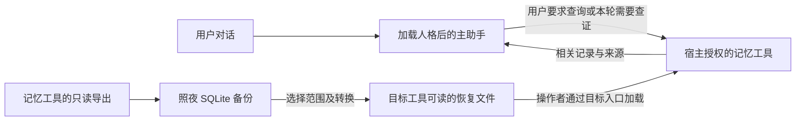

# 06 M2.1 记忆工具查询与备份回填设计

> 2026-11-25 开发设计。阶段状态见 [02 M2.1 里程碑](02-工程与里程碑.md#m21-记忆工具查询与备份回填)。

## 1. 会话与备份的职责

人格由照夜的人格入口加载，提供行为边界与持续偏好。主助手通过宿主配置的记忆工具获得本轮需要的历史信息。用户可以直接要求助手查记忆，也可以只提出问题，由助手判断是否需要调用工具。两条路径都使用当前会话的授权，结果作为回答依据，长期人格变更仍走人格更新入口。

备份由照夜管理。本地 SQLite 保存导入批次、来源、记录和版本。`backup search`、`backup record` 和 `backup verify` 用于检查备份内容、核对覆盖以及选取恢复范围。目标记忆工具从空库开始时，操作者可以从 SQLite 导出该工具可读的文件，并使用目标工具的入口加载。



会话入口沿用宿主已有的工具参数和响应格式。SQLite 的格式转换位于备份流程中。现有的人格服务、数据路径、CLI 和备份库 schema 可继续沿用。

## 2. 查询调用方式

| 用户意图 | 会话动作 | 回答依据 |
|---|---|---|
| 明确要求「查一下记忆库」 | 助手调用宿主提供的搜索工具，需要时按命中 ID 读取详情 | 相关记录和工具返回的可用来源 |
| 只提出历史问题 | 助手在本轮判断是否需要查证，并按相同授权调用工具 | 命中记录及其适用时间 |
| 工具返回零命中或错误 | 助手分别表达当前范围无结果或查询失败。需要恢复时由操作者启动备份流程 | 工具返回的实际状态 |

宿主选择主助手可调用的来源或工具，并保证范围和权限由受信任配置提供。工作 Agent 按原流程访问其记忆工具。DSH 会话中的工具选择与真机行为按 M4 的宿主接入计划验证。

## 3. 空库回填

### 3.1 目标与已有基础

首个验证目标采用 Mneme，因为 M2 已支持从真实 Mneme SQLite 导入照夜和从照夜导出独立的 Mneme SQLite 交换文件。2026-11-24 的实测在 Mneme 0.9.4 中读回全部 2,528 条记录，并核对了 14 个映射字段。M2.1 要补的是从空目标开始，通过**目标记忆工具的搜索和详情入口**完成回填后的查证。 [M2 实测](02-工程与里程碑.md#m2-备份库与检索)

2026-11-25 在隔离目录用合成数据验证 Mneme 0.9.4 的服务层。空库查询命中 0 条，从照夜按批次导出 2 条后，Mneme 的 `searchMemories` 命中 1 条可见记录，`getById` 返回完整样本正文。源库和照夜备份的 SHA-256 均一致。直接运行工具入口需要由 DSH 提供 `@deepseek-ai/dsh-tools`，正式工具入口的权限与错误用例待验收。

| 恢复目的 | 产物与使用方式 |
|---|---|
| 给空 Mneme 实例提供可检索的记忆 | `backup export-mneme` 生成新的 SQLite 交换文件，由隔离的 Mneme 实例通过自己的存储入口打开 |
| 留存整库信息 | 在允许保存整库快照时保留源 SQLite 原件，供检查向量、侧表、内部状态和历史载荷 |
| 适配其他记忆工具 | 根据该工具的公开导入格式增加转换器，复用备份的记录、版本与来源信息 |

### 3.2 首个恢复流程

1. 在照夜执行 `backup verify`，选定来源和已核验的完整批次，查看其截至时间和覆盖范围。
2. 通过 `backup export-mneme` 把选中范围转为独立的新文件。由操作者显式指定是否包含已经授权的无归属记录及历史归档。导出命令按当前授权视图处理记录，回填验收以该视图为比对口径。
3. 使用隔离的空目标实例加载交换文件。目标记忆工具负责打开、初始化自己的索引以及接受后续查询。
4. 先用目标工具执行一次搜索，再按命中 ID 读详情。比对恢复前后的记录数、抽样正文、归档状态和授权范围，并检查原备份和源库摘要。
5. 收集目标版本、备份批次、范围、导出计数和回读结果。目标打开、搜索或读取失败时保留失败原因与独立产物供诊断。

已有 CLI 命令可以作为恢复入口。下面使用明确的来源、批次和新文件路径。

```text
zhaoye backup verify --data-root <data-root>
zhaoye backup batches --source <source-id> --data-root <data-root>
zhaoye backup export-mneme --source <source-id> --batch <batch-id> --out <new-sqlite-file> --data-root <data-root>
```

批次和来源必须属于操作者的授权范围。恢复产物覆盖 M2 已映射的 `memories` 主表内容。正文采用 LF，向量、侧表和未映射的历史正文由授权保存的整库快照留存。对已有记忆的目标实例，合并和冲突处理沿用目标工具的受控流程。

## 4. 开发与验收

| 验收项 | 通过标准 |
|---|---|
| 空实例基线 | 隔离目标在加载前能正常查询，并对固定问题返回零条记录 |
| 生成兼容文件 | 完整批次和目标授权范围明确，导出完成且对应条数可核对 |
| 回填后可查 | 同一查询通过目标工具命中，按 ID 读取到预期正文，来源与可用时间一致 |
| 范围与失败证据 | 样本覆盖项目越权、归档、零结果和目标格式错误。结果分别反映授权、可见性与故障状态 |
| 数据完整性 | 原备份、Mneme 源文件的 SHA-256 在验收前后相同。独立产物可重复生成 |

实施顺序为复用现有转换命令、补一次隔离空库回填验收、记录目标工具的查询结果。后续会话集成使用同一工具能力，具体宿主接入见 [02 M4](02-工程与里程碑.md#m4-首个宿主接入)。
