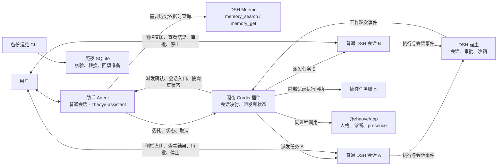

# 08 DSH 插件接入与跨会话派发设计

> 2026-11-25 · 首批接入已开发。照夜助手可向一个或多个普通 DSH 会话派发任务。任务状态由照夜插件监控。对应 [M4 首个宿主接入](02-工程与里程碑.md#m4-首个宿主接入)。

**照夜助手向其他普通 DSH 会话派发任务。** 指定会话 ID 时使用已有会话，省略时创建 DSH 的标准会话。独立任务可以分别派到多个会话，助手和目标会话可以并行。插件监控派发轮次并记录内部执行回执。用户在目标会话查看结果、审批和续聊。

## 1. 悬浮球和旧项目的实现

### 悬浮球的并行机制

`deepseek-harness-orb` 的悬浮球会话处理对话和即时交互，复杂工作通过 `code_agent` 派发。工作轨以普通会话出现在侧栏，可以打开、继续或停止。悬浮球自己的 Stop 只结束它的当前轮次。 [悬浮球项目说明](https://github.com/mini-yifan/deepseek-harness-orb#readme)

同作者的独立插件 `dsh-orb-cordis` 给出了可定位的实现，以下源码固定在 `390363b`。

1. 在悬浮球 Agent 的作用域注册 `code_agent`。首次委托调用 `sessionController.create`，按指定 preset、workspaceId 或 cwd 建立普通工作会话。继续已有会话时检查发起者归属、preset 和目录。 [会话创建源码](https://github.com/mini-yifan/dsh-orb-cordis/blob/390363bb20f77b03eb2d024111c88b74f1e0fd00/packages/computer-use/src/code-agent.ts#L334-L394)
2. 用 `sessionController.prompt({ requestId, sessionId, mode: 'queue', content }, signal)` 入队，宿主接受后即返回 `session_id`。目标会话在自己的 DSH Agent loop 运行，前台在收到入队结果后可以继续对话。 [排队及返回源码](https://github.com/mini-yifan/dsh-orb-cordis/blob/390363bb20f77b03eb2d024111c88b74f1e0fd00/packages/computer-use/src/code-agent.ts#L395-L430)
3. 监听器在工作轮次结束、发起者空闲后，用 `followup` 投递文本通知。悬浮球可对同一产物复用原工作会话，用户也可以在侧栏直接续聊。两条会话可以分别停止。照夜沿用这种可续聊的工作会话模型，任务结束时更新状态，完整结果由用户在工作会话阅读。 [完成通知源码](https://github.com/mini-yifan/dsh-orb-cordis/blob/390363bb20f77b03eb2d024111c88b74f1e0fd00/packages/computer-use/src/code-agent-completion.ts#L64-L114) · [会话续用源码](https://github.com/mini-yifan/dsh-orb-cordis/blob/390363bb20f77b03eb2d024111c88b74f1e0fd00/packages/computer-use/src/code-agent.ts#L371-L401)

DSH 也提供原生子代理。子代理的归属和恢复受根会话约束，适合一轮内部拆解。照夜首版采用普通会话模式，让用户能在侧栏独立查看、审批、继续或取消长任务。 [DSH 会话控制器](https://github.com/deepseek-ai/deepseek-harness/blob/master/packages/api/session-controller/README.md) · [原生子代理生命周期](https://github.com/deepseek-ai/deepseek-harness/blob/master/docs/upgrade-guide/v0.2.1-rc.2/agent-team-subagents/guide.md)

### 旧照夜可复用的部分

旧项目 `D:/workspace/myspace/zhaoye_old` 的 `plugins/assistant-dsh` 提供普通会话派发、项目映射和最小委托上下文的参考。旧版宿主记录覆盖加载及部分会话观察。参见旧项目 `docs/plan-assistant/DSH-HOST-VERIFICATION.md` 和 `plugins/assistant-dsh/src/delegate.ts`。

工具限制在 Agent 作用域注册并验证。委托状态按 `requestId` 绑定实际轮次，用户在同一工作会话追加的轮次独立运行。取消依据关联轮次的宿主终态确认。会话记忆直接使用宿主授权的原生 Mneme 查询。

## 2. 职责与数据流



- **助手 Agent** 理解意图、查 Mneme、回复用户和提出委托。照夜助手 preset 挂载人格与委托工具，向目标会话传递任务、验收条件和必要上下文。
- **目标会话** 沿用宿主的 preset、上下文、工具和审批。任务结果和产物引用随目标会话保存，用户可以在原对话追问或要求修改。
- **照夜插件** 负责宿主接入、派发和监控。插件通过 `@zhaoye/app` 读人格，通过 DSH 向目标会话排队，并依据关联轮次记录执行回执。
- **照夜应用** 提供人格、诊断、presence 和 SQLite 备份。会话查询调用 Mneme，SQLite 用于核验、格式转换和空库回填。各条会话的 Agent loop 由 DSH 运行。 [当前应用入口](../packages/app/src/index.ts) · [记忆查询与备份设计](06-M2.1-记忆工具查询与备份回填设计.md)

## 3. Cordis 组合包

1. `plugins/dsh` 的 Cordis 入口声明 `name`、`inject` 和 `apply`。`package.json` 的 `dsh.bundle.patch` 指向 `cordis.patch.yml`。组合包注册 host 服务和「照夜助手」preset。新建目标会话使用 DSH 自带的 `standard` preset。开发期用隔离 profile 安装本地构建包。 [DSH 组合包安装说明](https://github.com/deepseek-ai/deepseek-harness/blob/master/docs/user/develop/basic/publish.zh.md)
2. 宿主服务绑定在 `plugins/dsh/src/host.ts`，版本对应的调用形状集中在 `api.ts`。插件通过 `engines.dsh` 声明最低宿主版本 `>=0.2.2-rc.1`。首批使用会话控制器的 `create`、`prompt`、`events`、`updateQueue` 和 `cancel`，由宿主作用域提供工具与提示注册服务。 [插件清单](../plugins/dsh/package.json)
3. 开发包通过本地 `link:` 使用工作区内已构建的 `@zhaoye/app`。工具用 DSH 支持的 JSON Schema 定义经 `ctx.tools.register` 在 Agent 作用域挂载，执行时依据宿主提供的调用者身份、preset 和工作区重新校验权限。宿主 SDK 实例由 Cordis 提供。独立发布包与更高宿主版本兼容性在发布前验证。 [悬浮球工具入口](https://github.com/mini-yifan/dsh-orb-cordis/blob/390363bb20f77b03eb2d024111c88b74f1e0fd00/packages/computer-use/src/code-agent.ts#L282-L333)

### 人格分工与固定提示

首轮交付覆盖主助手对话与证据读取。人格 JSON 保持现有五段和版本，可逐段演进。当前固定提示包含安全内核、助手说明和经用户明确确认的简短回复口吻。查询支持按条目定位、按字段读取和完整章节分页。 [人格数据边界](01-架构基线.md#31-助手人格记忆) · [当前实现](../plugins/dsh/src/assistant.ts)

- **安全内核 `safety_kernel`** 保存每轮必须遵循的行为边界。原文进入系统提示，修改走用户明确授权的专门流程。工具权限仍由宿主执行。
- **用户画像 `user_profile`** 保存稳定的协作偏好和用户事实。读具体事实或偏好时带来源和确认状态，用户明确纠正优先。按需读取。
- **助手性格 `character_profile`** 保存照夜自己的语气和表达习惯。固定提示只选取用户明确提出或确认的 `reply-style` 条目，整理成单行后最多 50 码点。其他内容及超长口吻保留在画像中，供按需读取。
- **项目状态 `project_state`** 保存当前目标、决定、风险、阻塞和下一步。按项目与字段读取，保留时间和证据引用。历史经过由宿主记忆提供。
- **连续性摘要 `continuity_memory`** 提供共同经历的简短索引和原文引用。按需定位后向源端回查。完整跨会话历史由宿主授权的 Mneme 工具提供。

照夜助手固定提示首版目标为 **512 输入 tokens**。安全内核原文最多 320，身份和工具使用说明最多 128，短口吻、标题和分隔符共用 64 的装配余量。其余画像条目、项目清单和历史记忆按需读取。这个额度按首版固定内容拆分，用同一模型的 tokenizer 回测默认内核、较长规则和新版本规则，再决定是否调整。它只度量照夜贡献的固定段，宿主系统提示、工具定义和历史进入整次请求的计量。 [公共预算约定](03-记忆核心技术设计.md#7-预算)

当前 DSH 的计量接口结合历史返回的用量与估算值，暂以码点保护过渡。内核正文最多 320 码点，助手说明最多 128，固定段合计最多 512。内核预览、提交及回滚共用正文限制。超限或不可读的已存内核保留原文，提示装配报告错误并阻止发出缺少完整内核的照夜助手轮次。实际 tokens 需按模型 tokenizer 核对。待接通 DSH 最终请求计量后，记录峰值请求输入、整轮累计输入和模型调用次数，再启用 8,000-token 单请求门禁。

### 查询、定位与原文读取

1. **路由。** 普通对话直接回答。需要稳定偏好或当前项目状态时查询画像，需要往事或决策依据时调用宿主授权的 Mneme。显式查记忆与模型判断需要查证走同一授权路径。SQLite 继续提供备份选取、核验与回填。 [M2.1 回填设计](06-M2.1-记忆工具查询与备份回填设计.md)
2. **定位。** 已知条目 ID 时直接读取。未知 ID 时用 `zhaoye_identity_find` 在指定章节按名称和条目文本做确定性匹配，先 ID 和名称精确匹配，再短文本匹配。返回最多 3 条带 ID、短摘要、版本和更新时间的候选。历史用 `memory_search`，先关键词与可用的时间范围，必要时改写一次查询或请用户消歧。候选排序先执行可信作用域过滤，再比较相关性和时间。空结果、歧义和工具失败分别返回。
3. **读回。** `zhaoye_identity_read` 接受 `item_id`、`field` 和可选 `revision`。项目可精确读 `goal`、`decisions`、`progress`、`blockers`、`next_steps` 或 `evidence_refs`，其他章节按条目读。旧的目录与章节分页继续提供完整阅读。条目缺失返回 `NOT_FOUND`。版本变化返回 `CONFLICT` 并重新定位。长字段可带原选择参数、返回的版本及 `next_offset` 继续读取。历史按 Mneme 命中 ID 用 `memory_get` 读原文，保留来源、时间和必要引文。记忆工具返回按数据处理。
4. **控制回填体积。** 定位和详情的目标分别为 128 和 384 tokens。典型查证累计目标 512 tokens，第二组证据累计目标 1,024 tokens。过渡实现按序列化输出计量，定位最多 512 码点，详情最多 1,000 码点。Mneme 0.9.4 的原生 `memory_get` 返回全文，长正文预算需宿主投影或通过受信任的读适配器截取完整片段并保留原文引用。隔离验收关闭 Mneme 的自动注入和后台学习，确保答案来自显式读回。

可信 DSH profile 可通过 `allowedIdentityProjects` 限定画像中的项目可见范围。省略时沿用当前数据根的完整项目画像，空数组隐藏全部项目。查找、精确读取和整章分页共享同一范围。Mneme 工具继续使用宿主授予的独立权限。

照夜助手可按需读取同一数据根的三个数据域。`zhaoye_identity_history` 列出版本，可用 `snapshot_revision` 读取留存的历史画像。`zhaoye_backup_find` 和 `zhaoye_backup_read` 按来源和批次读取本地 SQLite 备份，保留导入时的范围和可见性规则。`zhaoye_asset_find` 和读取工具可访问已登记包的工作归档及其他原件，配置包维护走原生接口。 [个人资产库与配置包接入](09-M3-个人资产库与配置包接入.md)

### 自迭代入口与生命周期

为应用层预留 `ProfileEvolutionPort.propose(input)` 契约。输入为 `assistant_id`、`base_revision`、`evidence_refs` 和用户或会话触发来源。输出限定为用户画像或助手性格的候选变更，携带置信度和证据引用。以后经策略、版本冲突和来源校验，才可由既有人格更新入口提交。当前只有接口类型，助手对话和查证过程独立运作。

隔离验收使用显式测试数据根，加载照夜与原生 Mneme。先完成普通对话，再验证显式查询与主动查证的搜索、ID 读回和有据回答，最后验证空命中及查询失败。记录宿主版本、模型类型、工具轨迹及请求峰值。正式模型行为和 token 计量分别验收。

实现精确查询后，用旧分页基准中的最后一个项目复测。已知 ID 只读一次指定字段，未知 ID 正常情况一次定位加一次详情。用同一模型记录回答正确性、模型调用次数、峰值输入和累计输入 tokens，与章节分页基线比较。

同一宿主进程对每个数据根持有一个 `createZhaoye()` 实例。退出时停止接受操作并调用 `close()`。默认数据根曾被 `doctor` 判为 `SCHEMA_MIGRATION_REQUIRED`，正式接入前单独验证迁移。空闲释放与 handoff 按 M4 验收。 [应用生命周期](../packages/app/src/index.ts)

## 4. 派发、续聊与状态

- `zhaoye_delegate({ goal, acceptance, context, project_id?, target_session_id? })` 返回 `task_id`、`target_session_id` 和入队状态。已有会话和新建会话使用同一工具。已有目标必须是当前会话以外、所选工作区内的普通会话，插件通过 DSH 获取会话头验证，休眠会话的验证可以被动完成。不同会话可以同时执行各自任务，同一会话的多个任务由 DSH 排队。
- 已有目标会话使用发起方绑定的授权。照夜为该助手新建并成功入队的目标可直接复用，可信 profile 配置可以预授权一个或多个已有目标。其余已有目标由 DSH 原生审批授权本次派发。
- `zhaoye_task_status({ task_id })` 按会话归属授权，读取插件执行回执中的阶段、终态或失败原因，并提供可打开的工作会话。工作会话产生后续轮次时，本次派发仍保留自己的终态。
- `zhaoye_task_cancel({ task_id })` 按账本定位工作会话和派发轮次。排队时移除关联输入，运行时同时检查宿主已认领输入和会话历史，确认本次任务独占当前轮次后请求取消。共享轮次或归属仍不明确时，由用户在目标会话决定是否停止整轮。助手 Stop 只作用于助手自己的轮次。

### 一次委托的时序

1. 验证调用者和工作区，定位已有目标或分配新会话 ID。记录 `owner_session_id`、`target_session_id` 和本次 `request_id`，然后向宿主提交。对同一宿主调用的重试复用已有派发记录。
2. 用队列模式提交目标、验收条件和最小上下文，宿主接收后返回任务卡。前台继续对话。用户可在工作会话审批、补充信息或追问结果。
3. 插件监控宿主事件，按 `request_id` 找到本次输入并绑定 `turn_id`。订阅接上前发生的事件可从宿主会话历史补读。终态事件到达时生成执行回执，记录任务、目标会话、请求、轮次标识以及终态、结束原因和时间。重复事件去重，每次派发只留一份终态回执。交付质量由用户在目标会话核验。
4. **执行回执仅供插件和任务状态界面使用。** 任务卡、侧栏或显式状态查询读取回执投影。对话正文、结果、产物与后续交流保存在工作会话。
5. 宿主重启后逐条对账。接受状态不明时按原 `request_id` 查询，单条历史读取失败时记录待对账并继续其他任务。后续状态查询可重新核对宿主历史。用户可从原会话继续，重新派发由用户明确发起。

## 5. 开发顺序和真机验收

1. **装载与只读。** 在满足最低版本要求的 DSH Desktop 隔离 profile 加载组合包。助手能读人格和诊断，普通会话沿用宿主 preset 及权限。宿主退出时释放测试数据根。
2. **多个会话并行。** 同一助手分别向已有会话与新建标准会话派发有可控时长的任务，两个目标同时运行时，助手应能完成下一轮回复。目标执行受其宿主审批和工作区权限约束，各自状态独立查询。
3. **续聊、取消与恢复。** 从侧栏打开原会话并追加要求，验证原上下文可续用，后续轮次与原派发状态分开。测试同一事项派回原会话、助手 Stop 后目标会话继续、取消只作用于关联轮次，以及宿主重启后的状态对账。
4. **执行回执。** 使用普通自然语言结束工作轮次，检查插件仅依据宿主事件生成一条执行回执。通过状态工具查看，助手会话历史保持原有对话消息。续聊、重复事件、取消与重启时核对原派发轮次的回执。
5. **Mneme 与发布。** 验证助手能按需调用 Mneme 搜索和详情，空实例回填后可读。跑适配器 conformance 和 M4 真机清单。验收记录包含宿主版本、profile、preset、两个会话、关联轮次及观测结果。 [M4 一致性检查](02-工程与里程碑.md#m4-首个宿主接入)

DSH 0.2.2-rc.1 的隔离 Web profile 使用本地测试模型验证了向一个已有会话和一个新建标准会话同时派发。两个目标均运行时，助手完成了下一轮回复。测试也核对了原会话续聊、再次派发复用原会话、两项任务各自结束，以及执行回执仅由插件记录。Mneme 0.9.4 的隔离空库已验证原生搜索，详情工具已挂载。正式模型、桌面侧栏操作、回填后的详情读回和完整 M4 验收仍待验证。

2026-11-26 在 DSH 0.2.2-rc.5 的隔离 Web profile 验证了本地离线安装与 Cordis 配置合成，启动后本机 HTTP 返回 200。

2026-11-26 在同版本 DSH Web 隔离 profile 挂载 Mneme 0.9.4，以回环测试模型驱动真实「照夜助手」preset。关闭 Mneme 自动注入、自动摘要与后台整理。普通问候 1 次模型调用、0 次记忆查询。显式查记忆和独立会话中的历史问题均经过 `memory_search` → `memory_get` → 回答，各 3 次模型调用。搜索摘要只包含命中 ID 与预览，验收代号只在详情正文和最终回答出现。零命中与不存在 ID 的详情读取分别得到空结果和读取失败。另有 4 条 DSH 插件自动化测试通过。该验证使用合成数据和确定性模型响应，提供宿主运行与工具读回证据。正式模型的自主选工具、实际 token 用量与空库备份回填仍待验证。

人格查询优化分支在相同的 DSH 和 Mneme 版本上通过 link 安装复测。画像问题依次调用 `zhaoye_identity_find`、`zhaoye_identity_read`，从指定项目的 `blockers` 字段取证并回答，共 3 次模型调用。项目授权范围之外的条目返回无匹配。普通对话和 Mneme 的搜索、详情、零命中及读失败回归也通过。Windows 完整验证脚本退出 0，81 条测试通过，跨进程与 ACL 验收通过。

## 6. 本地开发安装

构建照夜工作区后，从仓库根目录把插件链接到新建的隔离 Web profile。

```powershell
pnpm build
dsh --profile zhaoye-dev --from-default-profile web --dump-config
$zhaoyePluginPath = (Resolve-Path -LiteralPath './plugins/dsh').Path.Replace('\', '/')
dsh plugin --profile zhaoye-dev add "link:$zhaoyePluginPath"
```

在该 profile 的 `cordis.patch.yml` 中为 `zhaoye-host` 指定绝对数据根。初次使用隔离数据时可显式启用初始化。

```yaml
- id: zhaoye-host
  config:
    dataRoot: D:/example/zhaoye-dev-data
    initIfMissing: true
    projectRoots:
      sample: D:/example/sample-project
    allowedTargetSessions:
      assistant-session-id:
        - existing-target-session-id
```

启动该 profile 后选用「照夜助手」preset。传入 `project_id` 时按 `projectRoots` 解析，省略时使用助手的当前工作区。传入 `target_session_id` 时继续指定对话，省略时在所选工作区新建标准对话。给多个会话派发时每个目标各提交一次。内部执行回执位于照夜数据根的 `dsh-tasks.sqlite`，正文和产物由各目标会话保存。

## 7. 正式安装与个人数据

**一次安装完成代码部署。** 发布者构建一个 DSH 组合包，包含 Cordis 配置层、DSH 适配入口和照夜中间框架的运行时代码。构建时把所需的 `@zhaoye/*` 内部模块打入同一个发布包，保留主入口和 `./assistant` 入口。用户安装发布版本时，DSH 从配置的软件源下载该包和公开运行时依赖，组合包自动加入当前 profile。安装产物必须能在没有照夜源码仓库和 workspace 依赖的机器上启动。 [发布单元决策](决策记录/0001-单仓多包与多适配器发布.md) · [DSH 组合包安装](https://github.com/deepseek-ai/deepseek-harness/blob/master/docs/user/develop/basic/publish.zh.md)

**一个指定目录保存个人数据。** `zhaoye-host.dataRoot` 指向用户选定的本地目录，独立于 DSH 的插件安装目录。人格和版本记录放在 `identity/`，照夜备份库与备份原件放在 `backup/`，个人资产清单和原件放在 `assets/`。应用启动时识别并打开该目录。已有有效数据直接加载，用户指定空目录时按初始化选项创建新根。存在旧版或不完整数据的目录由诊断报告处理方式。 [数据根布局](02-工程与里程碑.md#4-数据根与运行形态) · [配置包与空资产库](09-M3-个人资产库与配置包接入.md)

发布包携带程序和默认模板。安装或升级时沿用已配置的本地数据根。换机时先把完整数据根放到新机器选定的目录，再配置 `dataRoot`。会话记忆由宿主授权的 Mneme 等工具查询，照夜备份流程继续通过独立入口采集与回填。远端同步属于独立能力，需要明确的数据源和授权。 [会话查询与备份回填](06-M2.1-记忆工具查询与备份回填设计.md)

**预览包验收。** 2026-11-26 在 DSH 0.2.2-rc.5 的隔离 Web profile 离线安装了合并工作区运行时代码的 `0.1.0-preview.1` 本地压缩包。显式开启 `initIfMissing`，首次启动生成默认人格和初始版本、空 SQLite 备份库与导出目录、空资产清单与文件目录。SQLite 完整性检查通过。首次启动和重启均返回 HTTP 200，重启后人格、清单和测试资产原件一致。

**发布验收。** 正式发布时再验证升级沿用数据根、异常目录诊断、卸载后数据可重新打开，以及支持的宿主版本和系统组合。
