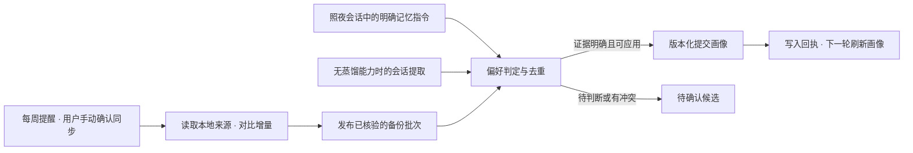

# 10 画像自迭代与增量记忆同步开发设计

> 2026-11-27 · 设计稿。适用于照夜在 DSH 中间歇运行的本地使用方式。

## 当前实现与试用

- 在照夜助手会话里说「以后读不到文件，先问我要路径或权限」。工具从宿主事件读原话，画像写入成功后返回版本。已确认的访问偏好和详细程度会进入下一轮的固定提示。其他长期偏好按需通过画像工具读取。
- 启用默认配置时，照夜在没有已确认蒸馏能力的情况下，从本会话中识别常见沟通偏好并登记候选。支持蒸馏的宿主可配置 `preferenceDistillation: true`。`autoEvolution: false` 暂停后台候选采集和同步回填，照夜会话中的明确记忆指令仍可写入。
- 每周五在照夜对话里询问是否同步。错过周五会在下一次使用照夜时补问。可用 `syncReminder.enabled`、`syncReminder.weekday`（0 为周日，5 为周五）、`syncReminder.timeZone` 配置。DSH 当前实现通过照夜对话交付提醒。
- 命令行入口为 `zhaoye backup sync --source <来源 ID>`、`zhaoye backup sync-status --source <来源 ID>` 和 `zhaoye preference list|apply|reject`。处理单条候选时给出候选 ID。DSH 内可以直接说「同步记忆」或「看看待确认的偏好」。
- 增量批次沿用 SQLite v1 的表结构，用批次格式与父批次回执识别。最近一次检查、偏好消费进度和提醒周期保存在 `backup/` 的 JSON 状态文件。保留 `backup import` 供用户主动制作完整快照。
- Mneme 回填只接收变化的可见偏好。来源会话可查且记忆正文与用户的明确偏好原话一致时自动应用。其余进入候选，带作用域的偏好可从原记忆按需查用。首版的会话识别采用规则，宿主蒸馏能力探测、模型候选提取和桌面通知由后续接入。

照夜在用户明确要求长期记住一条偏好时，当场更新画像。日常在其他 DSH 会话里由记忆插件积累的偏好，经过每周提醒发起的增量同步，再进入同一套画像更新流程。用户可以随时手动同步。

现有画像服务支持版本校验、幂等提交和回滚，SQLite 备份能够复用相同的正文版本。开发工作集中在偏好证据判定与候选管理、增量批次、提醒状态，以及 DSH 的反馈和提示刷新。 [人格更新](03-记忆核心技术设计.md#53-人格更新) · [备份设计](05-M2-备份库与检索开发设计.md) · [DSH 接入](08-DSH插件接入与并行Agent设计.md#自迭代入口与生命周期)

## 1. 使用方式

- 用户在照夜会话里说「以后读不到文件，先问我要路径或权限」。照夜提交一条长期协作偏好，并凭写入回执告诉用户画像版本。Mneme 的安装、运行和同步状态均为独立条件。
- 用户在其他 DSH 会话里工作时，由具备蒸馏能力的插件提取偏好。回到照夜后，实时记忆仍可用于回答。同步时仅将有明确用户证据的变化提为画像候选。
- 插件缺失、明确关闭蒸馏，或适配器确认不具备偏好提取能力时，照夜主动检查自己会话中新收到的用户消息。明确指令走即时写入，其余疑似长期偏好进入候选。插件仍在蒸馏、临时不可用和本轮无产出分别记录状态。
- 每周五产生一次待同步提醒。用户选择「现在同步」才启动任务。手动同步遵循相同的增量和恢复流程。

## 2. 分层与存储

- **`packages/contracts`** 定义经授权的用户事件引用、偏好候选、增量批次和同步回执。会话事件和备份中的来源记录共用候选契约，`ProfileEvolutionPort` 保留为后续的模型提取入口。
- **`packages/core`** 负责将证据映射为画像条目，判断适用范围、重复和冲突，复用现有画像更新规则。
- **`packages/app`** 负责汇合直接记忆和插件候选，串接增量备份、候选写入、用户确认和状态查询。CLI 与 DSH 调同一门面。
- **`packages/storage`** 在 SQLite 中持久化增量批次及查询所需的索引。画像继续以版本化 JSON 为权威。同步和提醒状态存入 `backup/`，候选和证据索引存入 `identity/`，随同一个数据根迁移。
- **`plugins/dsh`** 获取真实用户消息和生效的助手 preset，提供提醒、手动同步和候选确认，传递提交回执并刷新会话提示。

画像沿用单写者、`expected_revision` 和 `operation_id`。备份和画像分别提交，使用批次 ID、候选 ID 和操作回执联结。任务状态与提醒状态按数据根隔离。涉及来源路径的配置在迁移后重新绑定。 [数据域与不变量](01-架构基线.md#3-三个数据域)

## 3. 偏好采集和画像更新

### 3.1 用户明确要求记住

在照夜助手预设下提供 `zhaoye_preference_remember`，由宿主将无参数的调用绑定至当前轮的真实用户事件。应用层从受信任的事件读取原话，判定明确的长期偏好。带附件的消息、引用、工具结果和助手输出作为资料处理。

支持长期偏好的新增、明确纠正和撤回。诸如「今天先简短一点」的要求应用于本轮。一次性事实和工作经过用记忆查询或已有记忆工具处理。带项目作用域的偏好保留范围，首版将这类候选留给用户确认或按需查用。

成功时返回 `applied` 和实际画像版本。已存在同样条目时返回 `unchanged` 及当前版本。等待确认返回 `pending_confirmation`，并说明需要确认的内容。写入失败报告具体原因。助手根据回执选择「已记到画像 v…」「这条已在画像里」或「这条还需要确认」。

### 3.2 记忆插件提取及照夜主动提取

Mneme 适配器从已发布的增量批次读取新增或发生变化的 `preference`，保留原生 ID、记录版本、来源会话和作用域。照夜根据来源会话核对对应的用户事件。缺少可核对原话或来源不明时，将条目作为候选处理。首次建立基线时，历史偏好进入候选视图，后续按增量处理。

缺少插件蒸馏能力时，DSH 在照夜会话的成功轮次结束后交付新用户事件。适配器持久化已消费的会话游标，应用层优先用明确指令规则判定，其余可信且相关的消息才进入按需模型提取。首版每轮最多发起一次提取，只传入必要的用户片段及少量相关画像。候选写入成功后再推进游标。启用蒸馏的插件一时没有结果时，照夜仍处理用户明确要求记住的内容，其余消息等待插件结果。

### 3.3 合并、冲突和回滚

候选至少保存目标画像段、偏好键、操作类型、原话或证据引用、适用范围、处理状态和检查时的画像版本。对话用用户事件 ID 去重，插件用来源 ID、原生记录 ID 和版本去重。两个入口再按偏好键和规范值合并。常见明确规则可用确定性归一化，模糊相似度只提供候选匹配。

用户当轮明确要求长期记住即授权本次画像更新。后台自动应用需要启用自迭代，且只接受证据明确、适用范围清楚的协作偏好或沟通设定。用户确认的新表达可以更新已有条目。排序以用户原话的时间或会话顺序为准，插件摘要生成时间用于同步排序。历史总结、模型推断和作用域不明的条目需要确认。安全内核和工具权限继续走各自的授权流程。技术经验、项目进度和工作经过留在相应的原始数据域。 [人格数据边界](01-架构基线.md#31-助手人格记忆)

跨来源重复时，同一偏好只生成一次有效提交。第一次提交前为候选持久化 `operation_id`，重试复用该标识。CAS 冲突时读取新版本。条目未被并发改动时可重算后提交，目标条目发生改变时按最新证据判定或转为待确认。若返回 `COMMIT_UNKNOWN`，查当前版本、摘要和操作记录，再确定是否恢复。撤回或回滚时留下对应证据的处理状态，后续同步仍识别该版本已经处理。用户给出新的明确指令时重新判断。

### 3.4 保存后生效

画像提交成功即通知 DSH 刷新缓存。下一轮在使用新画像前核对 revision，使用已提交的短口吻，并在相关场景按需读偏好。资源读取失败时，可按 `NOT_FOUND`、`UNAUTHORIZED` 或范围错误的实际信息说明需要什么，再询问用户。固定提示沿用当前 512 码点上限，普通轮次保持短提示。达到画像条目上限时提示用户合并或替换条目，候选保留待处理状态。 [当前提示装配](../plugins/dsh/src/assistant.ts) · [预算契约](../packages/contracts/src/budgets.ts)

## 4. SQLite 增量同步

### 4.1 建立基线和识别增量

按已授权的来源、范围和转换器版本查找最近一个完整可用批次。同一来源的已有完整批次可作基线。缺少兼容基线时，首轮生成一次授权范围的逻辑基线。用户主动创建的原生 SQLite 快照仍可用于原格式恢复。

Mneme 首版在一个源库只读事务中读取授权范围所需的 ID 和用于比对的字段。用照夜自己的稳定摘要比较正文，并分别比较归档、忘记、权限和作用域等备份相关状态。扫描部分可以读取源库的逻辑记录，增量产物只保存有差异的项。上游带删除事件的可靠游标经适配验证后，可进一步减少源库扫描。 [当前只读采集](../packages/storage/src/mneme-file.ts) · [当前正文去重](../packages/storage/src/backup-db.ts)

- 新记录携带正文及必要元数据。
- 正文变化创建内容版本。归档或可见范围变化可以复用原正文版本，单独保存变化状态。
- 同来源、同授权范围的完整对账中确认某 ID 缺失时，记录为源端不可见。来自可靠变更源的明确删除事件标记为删除。
- 同步失败、源身份无法确定或来源策略发生变化时，保留上一可用批次。范围变更进入重新建立基线的流程。
- 无变化时只更新已检查时间与回执。已完成对账的空结果也算当天同步成功。

### 4.2 增量批次和查询

给导入批次增加 `snapshot` 和 `delta` 两种采集格式。增量批次保存基线、父批次、来源及授权范围、转换器版本、变更计数和差异文件摘要。SQLite 维护当前可见记录视图，基于父批次继承未变记录，再合并本批差异。历史查询与导出按所选批次恢复该时点的累计视图，沿用现有授权和可见性校验。

现有 `recordAbsences` 只适用于完整范围对账。增量发布接收明确的状态变化，沿用父批次中其余记录。否则未变化的记录会被当成缺失。正文索引继续依据内容版本更新，归档、删除和范围变化要同步影响查询可见性。 [现有批次发布](../packages/storage/src/backup-db.ts)

### 4.3 发布、迁移与恢复

差异文件先写临时目录，同步落盘并校验摘要，通过原子重命名发布到备份目录。随后在同一个 SQLite 事务中登记批次、变更和回执，并推进最新指针。同步状态在事务提交后写入。重启后的首次写操作核验中断作业的差异文件和父批次，继续发布可恢复的批次，其余作业标记失败。

新格式复用既有 SQLite 表定义。旧格式保留原来的完整或部分覆盖语义、记录 ID、版本和回执。增量链需要完整基线及父批次。日后做保留策略时，先验证可恢复的新基线，再淘汰被取代的备份链。

备份成功后才交付本批偏好。备份发布成功但画像处理失败时，记录画像消费进度，下次从同一批次继续。画像回执显示 `已应用`、`无变化`、`待确认` 或 `失败待处理`，避免把备份成功等同于画像已更新。

## 5. 周五提醒与手动同步

默认采用宿主本地时区，以周一至周日为一个周期。周五首次打开照夜时，如本周尚无成功的增量检查，则展示「有一段时间没同步，要现在同步吗？」。DSH 一直运行时由宿主在周五首次达到提醒条件时展示。周五没有打开，下次进入照夜时补一次，错过多周合并成一个待同步提醒。

提醒按数据根和周期保存，支持「现在同步」「稍后」。同一提醒只出现一份。用户本周已完成手动同步或检查确认无变更时，直接结束本周提醒。同步失败时展示该任务的待重试状态，沿用原提醒。未绑定本地记忆来源时，状态入口显示来源待配置。

DSH 关闭期间由下次启动补提醒。进程外通知可由 Windows 任务计划另行接入。同步始终受数据根实例锁与来源任务锁约束。同一来源已有同步在运行时，后续入口返回现有任务进度。退出时停止接收新任务，已运行的任务按现有实例生命周期结束或可恢复。

可信宿主配置项包括后台画像自迭代开关、每周提醒开关、提醒星期和时区。关闭后台自迭代后，已有候选仍可人工处理。关闭提醒后，手动增量同步仍可运行。旧数据根首次升级时，以启用时所在周期开始计提醒。

## 6. 用户入口和可核对结果

- `zhaoye_preference_remember` 提交当前用户明确表达的长期偏好，并返回实际画像版本或待处理状态。
- `zhaoye_preference_review` 让用户查看候选来源、原话及适用范围，再逐条应用或驳回。CLI 复用同一候选和确认服务。
- `zhaoye_sync_now` 手动发起增量同步。CLI 对应 `backup sync --source <source_id>`。作用域沿用已注册来源策略。
- `zhaoye_sync_status` 查询上次检查、成功批次及变更计数、待处理候选和错误。备份回执带来源批次，画像回执带操作 ID 和版本。

普通工作对话只在用户要求记住、主动同步、需要确认或任务失败时显示相应反馈。诊断可核对任务结果、提醒状态和画像版本。示例和验收使用合成数据。

## 7. 开发顺序与验收

### 第一阶段 当场记住

实现可信用户事件绑定、偏好归类、已有画像提交和 DSH 刷新。用没有记忆插件的隔离 profile 验证「以后读不到就先问我」，确认更新版本可读，并在下一轮遇到读取失败时按新偏好回应。重复同一事件只提交一次。临时要求、附件内指令、另一预设的事件和虚假证据进入正确的拒绝或只在当轮生效路径。验证用户纠正、撤回、回滚、并发版本冲突和提交结果未知。

### 第二阶段 增量备份与偏好回填

实现兼容基线、只读对账、差异产物、增量视图及偏好回填。用合成 Mneme 数据验证新增、正文更新、只变可见状态、归档、删除、权限变化和无变化。无变化时验证磁盘上没有新差异产物，重复处理同一偏好不增加画像版本。验证旧备份迁移、基线加多个增量后的完整查验与导出，以及范围变更、源库不可读和并发源写入。

### 第三阶段 每周提醒与恢复

用可控时钟测试周五打开、已开启跨到周五、关机错过多周、提前手动成功、同步失败、跨时区及重启去重。注入差异文件已写但事务尚未提交、备份已发布但画像未提交、画像已提交但任务未记账的中断。用隔离 DSH 首次启动和重启实测提醒、手动同步、已有画像读回及 Mneme 偏好回填。

每阶段运行仓库验证脚本，并记录合成数据的版本数、变更记录数、写入字节和失败恢复结果。首版验收以「明确记忆立即生效、每周提醒由用户发起同步、增量只保存差异」为准。 [工程验收入口](02-工程与里程碑.md)
