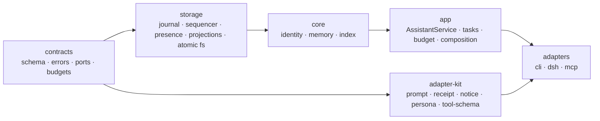

# 照夜 zhaoye v2 整体架构框架

> **版本**：v2.1 · 2026-10-26 · **状态**：🟢 已定（架构真源）
> **开发落地**：[DEVELOPMENT-DESIGN.md](DEVELOPMENT-DESIGN.md)（包规格、接口签名、里程碑）· **变更记录**：[adr/0001-multi-adapter-packaging.md](adr/0001-multi-adapter-packaging.md)
> **取代**：`zhaoye_old` 中作为“当前架构”的 [PROJECT-ARCHITECTURE-ARCHIVE-2026-10-23.md](../../zhaoye_old/docs/PROJECT-ARCHITECTURE-ARCHIVE-2026-10-23.md)（转为历史基线）
> **继承**：`DECISIONS-2026-10-23.md` 的 D1–D11，以及其中 §3.4 的已定分层
> **范围**：整体架构（分层、数据根、契约、关键流程、迁移、路线）。不写实现代码。
> **标记**：✅ 已确认｜🟡 设计已定、待落地｜⬜ 待拍板

---

## 0. 一页纸

**一句话**：照夜有一个身体（`~/.zhaoye` 数据根）、一份人格（profile 层语气 + 记忆核心画像）、一本不可篡改的账（追加日志），很多扇门（宿主适配器），但同一时间只开一扇门（单活 presence）。

```text
        门（adapters）                身体（data root）
   ┌────────┬────────┬────────┐      ┌───────────────────────────┐
   │  DSH   │  MCP   │  CLI   │ ───▶ │  journal/  唯一事实源      │
   │ plugin │ server │ sidecar│      │  projections/ 可重建投影   │
   └────────┴────────┴────────┘      │  presence/ 谁在门里        │
             │                       │  state/ 任务账本 + usage   │
             ▼                       └───────────────────────────┘
   ┌───────────────────────────────────────────────────────────┐
   │ app     AssistantService（唯一写入口 + 组合根 + 预算 + 任务）│
   ├───────────────────────────────────────────────────────────┤
   │ core    identity（画像）· memory（记忆）· index（路由）      │
   ├───────────────────────────────────────────────────────────┤
   │ storage journal · commit sequencer · atomic fs · presence  │
   ├───────────────────────────────────────────────────────────┤
   │ contracts  schema · errors · ports · budgets（依赖最底层）  │
   └───────────────────────────────────────────────────────────┘
```

**和旧系统的五个根本差别**

1. **一本账**：内容日志与元数据日志合并为一条带 hash 链的事件日志；跨文件“半成功”从根上消失。
2. **一切可重建**：`routes.json`、画像版本快照、指针都降级为投影；打开即对账，不靠人肉一致性。
3. **唯一门面**：任何入口都不能 `new` 核心；写只经过 `AssistantService` 的单一提交队列。
4. **失败分型**：崩溃撕尾＝自动修复并留审计；中段损坏/缺日志＝显式 `CORRUPT_DATA`，绝不降级成空库。
5. **人是主语**：presence 告诉用户“照夜现在在哪”，而不是抛一个 `LOCKED`。

**这一版不做什么**：不做 daemon、不做多工具同时写、不做向量库、不做自动蒸馏、不做 Web UI（§16）。

---

## 1. 设计输入与治理

### 1.1 输入

| 来源 | 吸收什么 | 处理 |
|---|---|---|
| `DECISIONS-2026-10-23.md` | D1–D11、单活 presence、TS + 轻量工具链、多宿主分级 | 全部继承；D10 改为“docs 入库” |
| 旧基线 §8 | P0-1…P1-10 与 8 条结构性问题 | 在 §2/§5/§6/§8 逐条给出结构性修复，不做补丁 |
| 旧基线 §10 | I1–I5、迁移/回滚流程、阶段 DoD | 扩展为 I1–I8，重排路线（§15） |
| 当前在办范围 | 人格注入从 `assistant` preset 上移到 profile/全局层 | 提升为独立“人格层”（§10），且**可在旧仓库单独交付**（P0′） |

### 1.2 三条主线（不变量级目标）

| 主线 | 回答的问题 | 架构承载 |
|---|---|---|
| **同一个人** | 换个工具，还是照夜吗？ | identity + persona + presence（单活） |
| **知道的事** | 它记得什么、凭什么记得、能不能带走？ | memory + 单日志 + 可导出投影 |
| **能干的活** | 让它干活会不会污染对话、会不会失控？ | 工作轨 + 任务账本 + 回执 + 审批 |

### 1.3 治理规则（防止再次“范围漂移 + 文档脱节”）

1. **单一范围权威**：本文件是“当前架构”的唯一真源；旧基线移入 `docs/archive/`，只读不改。
2. **ADR**：任何推翻本文的决定写入 `docs/adr/NNNN-*.md`，再改本文；不允许只在聊天里决定。
3. **文档入库**：`docs/` 纳入 Git（✅ yes，见 §17-1）。
4. **不变量有测试**：每条不变量（§2）至少一条可证伪的自动测试；没有测试的不变量视为愿望。
5. **同提交更新**：改契约/路径/预算，同一提交内更新对应章节与追溯表。

---

## 2. 不变量（架构的法律）

写代码前先把规则写死；任何实现都必须服从这些句子。

| ID | 不变量 | 可证伪的验收 |
|---|---|---|
| **I1** | **单一写者 + 单一提交序列**：同一数据根只有一个进程写；进程内所有写共享一条串行队列 | 50 次并发 `submit` 得到 50 个连续互异 `seq`；两个进程同时 open，第二个拿到带 owner 的 `ASSISTANT_PRESENT_ELSEWHERE` |
| **I2** | **日志是唯一事实源，投影可重建**：删掉整个 `projections/` 后，重放日志得到逐字节相同的投影摘要 | 投影目录删除 → 重开 → 摘要与删除前一致 |
| **I3** | **画像是版本化事实**：只能走 proposal → commit，指针与日志头不一致时以日志为准并自动重建 | 植入错误指针 → 重开 → 自动恢复且审计记录；普通记忆/回执/资料永不可改画像 |
| **I4** | **宿主、模型、执行器、外部来源都是端口**：core 不认识 DSH/MCP/HTTP；适配器不持有第二套业务逻辑 | dependency-cruiser：core 不得 import adapters/宿主 SDK；adapters 不得 import core/storage 具体实现 |
| **I5** | **不静默失败、不静默成功**：unknown 就说 unknown；只报 `reported_*`；降级必带标记；错误必须带“下一步做什么” | 每个错误码都有 `action`；失败注入测试断言没有“成功”返回值 |
| **I6** | **诚实覆盖**：查询结果必须区分 `complete` / `partial`，截断必须给游标 | 10 条命中、limit=5 → `partial` + `next_cursor`；无更多时 `complete` + `null` |
| **I7** | **预算是一等公民**：每轮/每次尝试一个 Budget 对象，装配前统一扣减并断言 | 超预算必然在发送模型前抛 `BUDGET_EXCEEDED`；不存在“事后才发现超了” |
| **I8** | **一扇门一次**：presence 由机制定义（进入/离开/崩溃/接管），不靠假设；活进程永不被自动抢占 | 崩溃/PID 死亡/心跳过期三种恢复各有测试；活锁场景强制接管被拒绝并给出手动路径 |

**与旧 I1–I5 的关系**：I1 增补“单一提交序列”，I2 从“投影可重建”扩展到“画像快照也是投影”，I4 增补“来源端口”，I5 增补“错误必须可操作”，新增 I6–I8。

---

## 3. 分层与依赖

### 3.1 分层



> 箭头 = 依赖方向：`contracts` 不依赖任何人；`storage` 只依赖 `contracts`；`core` 只依赖 `storage + contracts`；`app` 只依赖 `core + contracts`；`adapter-kit` 只依赖 `contracts`；`packages/cli` 与 `plugins/*` 依赖 `app + adapter-kit + contracts`。`app` 不依赖 `adapter-kit`。包与目录的对应见 §4。

### 3.2 层职责与硬规则

| 层 | 只做 | 绝不做 |
|---|---|---|
| `contracts` | Zod schema、推导类型、错误码、端口接口、预算常量、事件种类闭集 | 不 import 其他层；不含流程逻辑；不碰 `node:*` |
| `storage` | 追加日志、hash 链、提交序列器、原子写、路径安全、写者锁/presence、投影存储 | 不懂“记忆/画像”的语义；不判断业务对错 |
| `core` | 画像提案/应用/物化、记忆 CRUD、路由折叠与查询、幂等与 CAS 语义 | 不碰 `node:fs`（只经 storage）；不认识宿主；不调模型 |
| `app` | 唯一门面、组合根、串行化、预算、任务账本、维护（doctor/migrate/export） | 不 import 具体适配器；不 `new` 具体 Model/Worker |
| `adapter-kit` | 宿主无关的提示装配、回执校验、通知渲染、项目映射、工具 schema 生成、人格段 | 不直接读写数据根；不 import core |
| `packages/cli` 与 `plugins/*` | 宿主生命周期、命令、工具注册、模型 HTTP、本地 Worker 演示 | 不写 `journal/`、`projections/`；不绕过 `AssistantService` |

**唯一组合根**：`packages/app/src/composition.ts` 的 `createZhaoye(config)` 是唯一装配点（storage 实现、clock、worker/model 端口、projections 一起注入）。适配器只能拿到 `AssistantService`，拿不到存储或核心实例。

### 3.3 依赖规则（用 dependency-cruiser 守，不靠自觉）

依赖规则必须覆盖以下边界：

| 规则 | 来源 | 约束 |
|---|---|---|
| `contracts-pure` | `packages/contracts/src` | 仅允许本包与 zod；禁止 Node 内建模块及其他依赖 |
| `storage-no-domain` | `packages/storage/src` | 禁止依赖 core/app/adapter-kit/cli/plugins |
| `core-no-fs` | `packages/core/src` | 禁止 `fs`、`path`、`os`、`child_process` 的 `node:` 和裸导入形式 |
| `core-no-upper` | `packages/core/src` | 禁止依赖 app/adapter-kit/cli/plugins |
| `app-no-adapters` | `packages/app/src` | 禁止依赖 adapter-kit/cli/plugins；app 只依赖 core + contracts |
| `kit-pure` | `packages/adapter-kit/src` | 只依赖 contracts；禁止 Node 内建模块和更高层 |
| `plugin-public-only` | 各 `plugins/<name>/src` | 只允许本插件、app/adapter-kit/contracts 公开入口、已声明的宿主 SDK 与 Node 内建模块；禁止其他插件 |
| `no-cross-internal` | 所有包源码 | 禁止跨包导入另一包的 `src/internal/`，包内可用自己的 internal |
| `no-circular` | 所有包源码 | 禁止循环依赖 |

`.dependency-cruiser.cjs` 从明确的包名清单生成逐插件边界规则和逐包 internal 规则，不依赖 `from.path` 捕获组向 `to.path` 插值。扫描只包含 `packages/*/src`、`plugins/*/src`，不把测试依赖当作生产依赖。验收须包含允许导入的正例和越界导入的反例。失败信息要能指导修复（例如 `core-no-fs: packages/core/src/identity/apply.ts → node:fs`），而不是只报“违规”。

---

## 4. 仓库结构（单仓多包）

> 2026-10-26 变更：由「单包 + 插件子包」改为「单仓多包」。取舍与被否决方案见 [ADR 0001](adr/0001-multi-adapter-packaging.md)。

```text
zhaoye/
├─ package.json                 # 私有根包：workspaces + 脚本 + 固定 packageManager（不发布）
├─ pnpm-lock.yaml               # 唯一依赖锁文件，提交入库
├─ pnpm-workspace.yaml          # packages/* + plugins/*；根级 tests 不作为 workspace 包
├─ tsconfig.base.json           # 唯一编译基线（strict 等）
├─ biome.json                   # 唯一 lint/format
├─ .dependency-cruiser.cjs      # 唯一架构规则（跨包也守）
├─ packages/
│  ├─ contracts/                # @zhaoye/contracts：类型 + zod schema + 错误码 + 预算
│  ├─ storage/                  # @zhaoye/storage：journal / sequencer / presence / atomic-fs
│  ├─ core/                     # @zhaoye/core：identity / memory / index
│  ├─ app/                      # @zhaoye/app：AssistantService + 组合根 + 任务账本 + 预算
│  ├─ adapter-kit/              # @zhaoye/adapter-kit：prompt / receipt / notice / persona / tool-schema
│  └─ cli/                      # @zhaoye/cli：bin `zhaoye`（init/doctor/presence/migrate/export）
├─ plugins/
│  ├─ dsh/                      # dsh-plugin-zhaoye：DSH 进程内插件
│  └─ mcp/                      # @zhaoye/mcp：MCP server（tools/resources）
├─ tests/
│  ├─ tsconfig.json              # 根级测试编译配置，不是 workspace 包
│  ├─ adapter-conformance/      # 每个插件都要过的同一套断言（§11.5）
│  └─ integration/              # 跨包端到端
├─ presets/                     # kernel 模板 / persona 模板（与代码同源）
└─ docs/{ARCHITECTURE.md, DEVELOPMENT-DESIGN.md, adr/, archive/}
```

**包内结构**：`src/index.ts` 是唯一公开面，`src/<domain>/` 放实现，`src/internal/` 不导出。源码用 `tsconfig.build.json` 编译到 `dist/`；包内 `test/` 用独立 `tsconfig.test.json` 编译到 `dist-test/`。根级 `tests/` 有独立 `tsconfig.json`，编译到 `tests-dist/`，不是 workspace 包；测试统一通过根脚本执行。共享 `tsconfig.base.json` 不设置会把测试排除在外的 `rootDir: "src"` / `outDir`。`.gitignore` 忽略 `node_modules/`、`**/dist/`、`**/dist-test/`、`tests-dist/` 与 `*.tsbuildinfo`。

**包策略**：8 个包，统一版本号一起发布；`packages/*` 不作为独立库发布，`plugins/*` 是宿主插件安装物；发布时把 `@zhaoye/*` bundle 进插件，用户侧不解析内部包。`packages/cli` 在 T0 是内部 CLI 入口；在交付用户可安装 CLI 前，须另行确定发布形态并记录 ADR。新增宿主只加一个 `plugins/<host>/`，不改 core 一行。触发「再拆包」的条件不再是第二适配器（已发生），而是「需要独立发布 core」或「单包体积/编译时间成为瓶颈」。

---

## 5. 数据根 v3 与事件日志

### 5.1 布局

```text
<data-root>/                        # 默认 ~/.zhaoye
├─ manifest.json                    # { format:'zhaoye-data', schema_version:3, assistant_id, created_at }
├─ journal/
│  ├─ seg-000001.jsonl              # 唯一事实源；按大小/条数滚动，封存段只读
│  ├─ seg-000002.jsonl
│  ├─ index.json                    # 派生：段 → [first_seq,last_seq,events,bytes,digest]
│  └─ tip.json                      # 派生：{seq, digest} 缓存，缺失则重放
├─ projections/                     # 全部可删、可重建（I2）
│  ├─ identity/current.json          # { revision, identity_hash, applied_seq }
│  ├─ identity/versions/000001/      # kernel.md / user-profile.json / habits.json / snapshot.json
│  └─ memory/routes.json             # { up_to_seq, up_to_digest, entries[] } 检查点
├─ presence/
│  └─ owner.json                     # 活锁元信息（§6.3）；history 走日志
├─ state/
│  ├─ tasks.json                     # 任务账本（自身是真源，不在记忆日志里，见 D6）
│  └─ usage.jsonl                    # 模型用量观测，不参与业务事务
├─ audit/                            # 强制接管、迁移、修复的审计与备份指针
└─ backup/<utc-ts>/                  # 仅维护操作创建，用户可删
```

**相对旧版的关键变化**

| 旧 | 新 | 为什么 |
|---|---|---|
| `data/user-explicit/records.jsonl` + `state/events.jsonl` 双日志 | `journal/seg-*.jsonl` 单日志 | 消除跨文件非事务；一条 `seq` 就是一个提交 |
| `index/routes.json` 是“投影但被当真相” | `projections/memory/routes.json` 只是检查点 | 打开时对账；删除后重放可还原 |
| `identity/versions/` 是文件真相 | 日志是真源，版本目录是物化结果 | 指针/目录/日志三者不一致时以日志为准，自动重建 |
| manifest `schema_version:2` | `3`（布局变更） | 迁移工具据此分派 |
| `docs` 不入库 | 入库 + `archive/` 冻结旧文档 | 文档与代码同版本历史 |

### 5.2 事件信封

```ts
interface EventEnvelope {
  v: 3;
  seq: number;            // 1..n，连续；重复/跳号即 CORRUPT_DATA
  id: string;             // uuidv7，便于按时间排序
  at: string;             // ISO8601 带偏移
  op: string;             // 调用方幂等键
  fingerprint: string;    // sha256(canonical({kind, payload}))：完整意图，不是部分字段
  prev: string;           // 上一条 digest，形成 hash 链
  digest: string;         // sha256(canonical(envelope 去掉 digest))
  kind: EventKind;        // 闭集，见 §5.4
  actor: { adapter_id: string; host?: string; session_id?: string };
  payload: unknown;       // 按 kind 分派到具体 Zod schema
}
```

- `op` 幂等：同 `op` + 同 `fingerprint` → 返回原回执（不重复写）；同 `op` + 不同 `fingerprint` → `CONFLICT`。指纹覆盖完整请求（修复旧 P1-1：tags/occurred_at/evidence 也参与）。
- `prev` 链让“尾完整性/检查点有效性”可以只读常数条记录验证，不必每轮全量重算（修复旧 P0-4 的同类问题）。
- 一行一事件，追加后 `fsync` 才返回（默认 `durability:'sync'`）。

### 5.3 损坏与恢复语义（替换旧“一律 CORRUPT_DATA”）

| 情况 | 处理 | 依据 |
|---|---|---|
| 尾部半行（最后一个 `\n` 之后的残留，无合法 digest） | **打开时丢弃并审计** `journal.torn_tail_repaired`（记录字节数/段名）。已提交 seq 不变 | 崩溃撕尾是正常物理现象，不是数据损坏 |
| 中段坏行 / digest 不匹配 / `prev` 断链 | `CORRUPT_DATA`，转只读诊断，拒绝写入 | 无法区分“损坏”与“篡改” |
| `seq` 跳号 / 重复 | `CORRUPT_DATA` | 不静默去重 |
| manifest 显示已初始化但日志缺失/为空 | `CORRUPT_DATA`（**不得当空库**，修旧 P0-2） | 文件丢失 ≠ 没有记录 |
| 投影缺失/落后/摘要不符 | 自动重建投影 + 审计（不是错误） | I2 |
| 检查点与日志头不一致 | 以日志为准，重建检查点 | I2 |

> 原则：**可以自动修复的（撕尾、投影）自动修并留痕；不能确定意图的（中段损坏、缺日志）一律停下并说清楚。**

### 5.4 事件种类（v1 闭集）

| 域 | kind | payload 要点 |
|---|---|---|
| 画像 | `identity.proposed` | proposal_id、before/after revision、patch_hash、字段级 diff |
| | `identity.applied` | revision、快照三文件内容 hash、组合 hash、previous_revision、proposal_id |
| 记忆 | `memory.recorded` | MemoryItem v3（含 source、attribution、evidence、revision=1） |
| | `memory.revised` / `memory.archived` | record_id、expected_revision、新快照/状态 |
| 索引 | `index.hint` | record_id、路由摘要（可选优化；缺失也能从 memory.* 折叠出来） |
| 设置 | `settings.updated` | projectMap、预算覆盖（只允许收紧不允许放宽到超上限） |
| presence | `presence.entered` / `presence.released` / `presence.takeover` | host、pid、session_id、原因、旧 owner 快照 |
| 维护 | `maintenance.repaired` / `maintenance.migrated` / `maintenance.exported` | 动作、输入摘要、结果摘要 |

**不放进日志的**：任务账本（D6）、usage、备份文件、宿主 UI 状态。

### 5.5 段滚动与容量

- 单段上限：32 MiB 或 50,000 事件，先到为准；封存段不可改。
- `journal/index.json` 与 `tip.json` 是派生缓存，缺失时全量重放（正确性不依赖它们）。
- 容量接近时**预留结算空间**：剩余不足 1 MiB 时拒绝新任务、只允许收尾写入并给 `MAINTENANCE_REQUIRED` + 导出指引。
- 压缩/归档（M5）：把封存段导出为 `export/<ts>/seg-*.jsonl`、写 `maintenance.exported`，不删除原件；删除只由用户在备份后手动执行。

---

## 6. 存储内核

### 6.1 提交序列器（I1 的唯一实现）

```ts
interface CommitSequencer {
  submit(mutation: Mutation): Promise<CommitReceipt>; // 串行；所有写都走这里
  head(): { seq: number; digest: string; at: string };
  close(): Promise<void>;
}
interface Mutation { kind: EventKind; payload: unknown; op: string; actor: Actor }
interface CommitReceipt { seq: number; digest: string; at: string }
```

临界区（一次 `submit` 内顺序执行，不可重入）：

```text
1 校验 payload（Zod，按 kind）
2 查 op 指纹  ── 已存在且相同 → 直接返回原回执（幂等）
│              └ 已存在但不同 → CONFLICT
3 seq = head.seq + 1；prev = head.digest
4 canonical 编码 → 追加一行（seg 当前段）
5 fsync 落盘（durability=sync）
6 更新 head / opIndex / 内存投影（routes、identity 指针）
7 触发检查点写（去抖 ~200ms，异步，失败只告警不影响回执）
8 返回 CommitReceipt
```

要点：

- **任何绕过 `submit` 的写入都视为架构违规**，由测试扫描 `storage` 外的 `appendFile/writeFile` 调用。
- 内存投影更新在临界区内完成，读路径不需要 fs。
- 去抖检查点写失败不回滚事实；下次打开自然重建。
- `durability:'batch'` 预留但不默认（v1 只实现 `sync`）。

### 6.2 打开顺序（`open`）

```text
1 读 manifest → 校验 format/schema_version（2 则提示 migrate，不自动升）
2 读 presence 状态（见 §6.3）→ 拿不到锁就返回 ASSISTANT_PRESENT_ELSEWHERE + owner 摘要
3 读 journal/index.json（可选）→ 校验段清单；缺段立即 CORRUPT_DATA
4 重放：逐行校验 seq/prev/digest；末段半行则撕尾修复并审计
5 校验 manifest 声明 vs 实际日志（已初始化但空 → CORRUPT_DATA）
6 折叠内存投影（routes / identity 当前版本）
7 校验 projections 检查点：
     摘要一致 → 直接采用；不一致/缺失 → 重建并审计
8 校验 identity 指针 vs 日志头：
     一致 → 采用；不一致 → 以日志物化，重建指针并审计（I3）
9 启动心跳；append presence.entered（锁已在步骤 2 获得）
10 返回运行时句柄
```

**成本目标**：10k 事件 + 有效检查点时 ≤300ms；全量重放 ≤1.5s（§14.4）。

### 6.3 presence（单活，D11 落地）

**状态机**

```text
free ──acquire──▶ held ──release──▶ free
                    │
                    ├─ 进程崩溃 / PID 消失 / 心跳 ≥3 周期未更新 ──▶ stale
                    │                                                  │
                    │                       安全路径（pid 已死且心跳过期）
                    │                                                  ▼
                    │                                              free（自动恢复 + 审计）
                    │
                    └─ 活进程但无响应 ──用户显式 force──▶ takeover（备份 + 审计 + 换锁）
```

**owner.json**

```json
{
  "host": "dsh",
  "host_name": "DeepSeek Harness",
  "pid": 12345,
  "instance_id": "0192f0c5-...",
  "session_id": "...",
  "started_at": "2026-10-26T12:03:00+08:00",
  "heartbeat_at": "2026-10-26T12:08:00+08:00",
  "heartbeat_interval_ms": 60000,
  "assistant_id": "...",
  "adapter_version": "0.1.0"
}
```

**规则**

| 场景 | 行为 |
|---|---|
| 第二个宿主 open | `ASSISTANT_PRESENT_ELSEWHERE`，附 owner 摘要与人类可读文案；不暴露记忆内容 |
| 宿主正常退出 / 插件卸载 | `release`：append `presence.released` → 删 owner → 删锁目录 |
| 窗口关闭 | **不算离开**（Electron 类宿主可能驻留） |
| 切到另一个工具 | 显式 handoff：当前门先 `release`，下一个门再 acquire；**不做隐式抢占** |
| 空闲超时 | 默认**开**（15 分钟无提交、且无进行中任务）→ 自动 `release`，append `presence.released{reason:'idle_timeout'}`；可配置关闭 |
| 崩溃 | PID 探测 + 心跳双条件过期才自动清；空锁超过宽限期才清 |
| 活锁 | 永不自动抢占 |
| 强制接管 | CLI `zhaoye presence takeover --force`：先备份 → 确认旧进程已死或用户二次确认 → append `presence.takeover`（含旧 owner）→ 原子换 owner → 写 `audit/takeover-<ts>.json` |
| 其他工具 peek | 允许只读 `presence/owner.json`；**默认不允许读记忆**（可配置，见 §17-6） |
| 同一进程再次 open | 同 `pid` + 同 `instance_id` → 返回原句柄（幂等）；同 `pid` + 不同 `instance_id` → `ASSISTANT_SAME_PROCESS` |

**handoff 与同进程**（2026-10-26 新增）

- 每个插件必须提供「让照夜离开」动作，等价 `release`，不要求用户回 CLI。
- `owner.json` 的 `instance_id` 在每次 open 时生成（uuid），用于区分同一宿主进程内的多个实例，避免把同进程的第二次 open 误判成「活锁占用」。
- 空闲超时只在任务账本无 `created/dispatched/running` 任务时生效；有进行中任务时只告警、不释放。

**文案示例（错误里直接可展示）**

> 照夜现在在 DeepSeek Harness（今天 12:03 起，已运行 41 分钟）。
> 请先在那边执行「让照夜离开」，或确认它已退出后重试。
> 如果你确定那个进程已经不在了，可以运行 `zhaoye presence takeover --force`（会先备份数据）。

**心跳**：60s 写一次（先写临时文件再 rename，避免半写）；写失败不阻塞业务，只在下次 open 时体现为心跳过期。

### 6.4 原子文件

- 写入模式一律 `tmp → fsync(file) → rename → fsync(dir)`；Windows 上 rename 覆盖需要 `fs.rmSync` 先删或使用 `rename` 的替换语义，测试必须覆盖。
- 路径安全：所有外部传入路径先 `resolve` + 前缀校验；禁止符号链接穿越（保留旧实现与测试）。
- 每个 `data root` 的临时文件统一放 `<root>/.tmp/`，open 时清理超过 1 小时的残留。

---

## 7. 记忆核心

### 7.1 identity（画像）

- **组成**：`kernel`（人格）+ `user_profile`（`display_name` + `facts[]`）+ `habits`（闭集模板 ID）。
- **预算**：三部分拼成文本 ≤1600 码点；在 `identity.apply` 一处校验（唯一执行点）。
- **流程**：`propose`（写 `identity.proposed`，含字段级 diff）→ `commit(proposal_id, expected_revision)`（CAS）→ 写 `identity.applied` → 物化 `versions/<rev>/` + 指针。
- **物化**：先写 `projections/identity/versions/.staging-<rev>/` → rename → 原子替换 `current.json`。中断时旧指针仍有效；下次 open 按日志重建。
- **校验**：open 时校验“指针 == 日志头”一次；运行期只比 revision/hash（O(1)），不再每轮全链重算（修旧 P0-4）。
- **幂等**：同 `proposal_id` 重复 commit 返回原回执；目标版本已存在且内容一致则不覆盖。
- **禁止**：记忆写入、任务回执、模型输出、外部来源数据一律不得改画像；只有 proposal/commit 两条路。

### 7.2 memory（显式记忆）

`MemoryItem` v3 字段（相对旧版的改动加粗）：

| 字段 | 约束 |
|---|---|
| `record_id` / `revision` | UUID / 正整数，CAS 用 `expected_revision` |
| `scope_id` | = 数据根 `assistant_id` |
| `project_id` | 可空；项目隔离 |
| **`source`** | `{ source_id: string; native_id?: string }`，不再硬编码 `user-explicit`（为外部来源留位） |
| `status` | `active` / `archived`（软删除） |
| `content` | ≤4096 码点 |
| `tags` | ≤12 个，每个 ≤40 字符 |
| `attribution` | `origin` / `attributed_to` / `user_stance` / `derivation` 四元组（保留） |
| `evidence` | ≤5 条，默认 `{kind:'request', ref:request_id}` |
| `source_state` | `available` / `unavailable` / `stale` / `suppressed` |
| `occurred_at` | 用户所述发生时间；参与幂等指纹 |

**写入准入**：只有“显式意图”能写。准入由适配器签发 `WriteIntent { explicit: true, actor: 'user', adapter_id, operation_id }`，CLI 的 `/remember` 与插件工具调用是唯一签发点；普通聊天文本、模型推断、资料引用都不能自行生成该意图（D4 的机制化）。

**修订/归档**：`replace` / `archive` 必须带 `expected_revision`；CAS 失败 → `CONFLICT`，不覆盖。

### 7.3 index（路由）

- **折叠**：打开时把 `memory.*` 事件折叠成内存路由表 `Map<record_id, RouteEntry>` + 按 `created_at` 排序的列表；之后每次提交增量更新（修旧 P0-3：查询不再全量重建）。
- **检查点**：`routes.json = { up_to_seq, up_to_digest, entries[] }`；`up_to_digest` 与日志 hash 链对照即可判定是否可用。
- **重建**：`zhaoye maintenance rebuild-projection` 显式执行；查询路径**永不**触发重建。
- **检索**：v1 保持“正文/标签子串（大小写不敏感）+ 项目/来源过滤”，10k 条内存扫描为微秒级。语义/向量检索明确不做（§16），但 `RouteIndex` 接口预留实现位。
- **SQLite**：v1 不引入（§17-3）。触发点：>20k 条记忆或需要跨字段复杂查询时，再作为**投影实现**接入，不改日志真源。

### 7.4 QueryContext（修旧 P1-6）

```ts
interface QueryContext {
  scope_id: string;
  project_ids: string[] | '*';   // 本轮被授权的项目集合
  source_ids: string[] | '*';
  limit: number;                 // 默认 5，上限 20
  cursor?: string;
}
interface LocateResult {
  hits: RouteEntry[];
  coverage: 'complete' | 'partial';
  next_cursor: string | null;
  context_digest: string;        // 同一轮 locate/recall 必须一致
}
```

- `locate` 与 `recall` 用**同一个** `QueryContext`；`recall` 校验 `context_digest` 与项目归属，因此“locate B → recall B”必然成功。
- `coverage` 只在确实取完时才 `complete`；截断必须给游标（I6）。
- 子串匹配命中数为 0 时返回 `complete` + 空数组，并在文案里区分“没查到”与“没权限查”。

### 7.5 预算（唯一常量表在 `contracts/budgets.ts`）

| 项 | 值 | 执行点 |
|---|---|---|
| L0 画像 | 1600 码点 | `identity.apply` + 装配断言 |
| L0′ 人格语气 | 400 码点 | persona 渲染 |
| L1 记忆目录 | 600 码点 / 5 条 / 标题 30 | 装配 |
| L2 置顶正文 | 600 码点 / 3 条 / 每条 300 | 装配 |
| 固定注入合计 | 2800 码点 | **唯一函数** `assertFixedBudget()` |
| 单条工具结果 | 1000 码点 | 适配器回填 |
| 回执 summary | 600 码点 | 回执校验（超限截断，不整份降级） |
| 单条日志事件 | 64 KiB | 提交序列器 |
| 单次读（本地 Worker） | 200 行 / 6000 码点 | cli（LocalWorker） |
| 模型单请求 token | 8000 | model-chat |

> 旧版“预算声明了但执行点不全”的问题，用“常量唯一 + 执行点唯一 + 断言测试”解决。改预算必须同时改测试。

---

## 8. 应用层：唯一门面与组合根

### 8.1 AssistantService（唯一写入口）

```ts
interface AssistantService {
  // 画像
  readIdentity(): Promise<IdentitySnapshot>;
  previewIdentityUpdate(req: IdentityUpdateRequest, ctx: ActorContext): Promise<IdentityProposal>;
  commitIdentityUpdate(proposalId: string, expectedRevision: number, ctx: ActorContext): Promise<IdentityCommit>;
  // 记忆
  locate(ctx: QueryContext): Promise<LocateResult>;
  list(ctx: QueryContext): Promise<LocateResult>;
  recall(recordId: string, ctx: QueryContext): Promise<MemoryItem>;
  remember(intent: WriteIntent, input: RememberInput): Promise<CommitReceipt & { recordId: string }>;
  replace(intent: WriteIntent, recordId: string, expectedRevision: number, input: ReplaceInput): Promise<CommitReceipt>;
  archive(intent: WriteIntent, recordId: string, expectedRevision: number): Promise<CommitReceipt>;
  // 运行态与维护
  presence(): Promise<OwnerInfo | null>;
  doctor(): Promise<DoctorReport>;
  close(): Promise<void>;
}
```

- **没有第二个写路径**：`core` 的构造函数不导出；`storage` 的 `append` 不导出；CLI 不再 `new MemoryCore`（修旧 §8.2-1）。
- **串行化**：写由 `CommitSequencer` 串行；读走内存投影，不加锁。`AssistantService` 不做自己的队列，避免“两套队列互相不知道”。
- **归属校验**：`commitIdentityUpdate` 校验 `proposal.adapter_id == ctx.adapter_id`；跨适配器提交 → `UNAUTHORIZED`。

### 8.2 组合根

```ts
// app/composition.ts —— 全仓唯一 new 具体实现的地方
export async function createZhaoye(cfg: ZhaoyeConfig): Promise<Zhaoye> {
  const clock = cfg.clock ?? systemClock;
  const presence = await presenceStore.acquire(cfg.dataRoot, cfg.host); // 失败即抛出带 owner 的错误
  const journal = await journal.open(cfg.dataRoot);                    // 含 §6.2 全部校验
  const sequencer = createSequencer({ journal, clock });
  const identity = createIdentityService({ sequencer, journal, store: projectionStore });
  const memory = createMemoryService({ sequencer, journal, index: routeIndex });
  const service = new AssistantService({ identity, memory, tasks, budgets, clock, presence });
  return { service, close: () => service.close() };
}
```

**注入点**：`clock`（测试可控时间）、`worker`（`WorkerPort`）、`model`（`ModelPort`）、`source`（`SourcePort`）、`notifier`（`HostPort`）。测试通过替换这些端口做失败注入，不需要 mock 文件系统。

---

## 9. 任务与回执

### 9.1 账本

- **位置**：`<data-root>/state/tasks.json`（统一一处，取代旧本地 `events.jsonl` + 插件 `~/.dsh/assistant-dsh/tasks.json` 两套）。
- **边界**：不写入记忆日志（D6）；任务成功不依赖记忆写入；任务数据不随记忆导出迁移。
- **写入**：只在获得 writer lock 期间写；原子替换；上限 200 条（超出归档到 `state/tasks.archive.json`）。

### 9.2 状态机（补 created 恢复）

```text
created ──dispatch──▶ dispatched ──start──▶ running ──▶ completed
   │                       │                   │
   │                       │                   ├──▶ failed（可重试）
   │                       │                   └──▶ cancelled（用户取消）
   └──────────────┬────────┴───────────────────┘
                  ▼
               unknown（重启/超时）── retry ──▶ 新 attempt
                                  └─ cancel ─▶ cancelled
```

- **不变量**：任何非终态都必须至少有“用户可执行的出口”（retry / cancel），不再出现旧 P1-2 的“永久占位”。
- `created/dispatched` 在 open 时统一转 `unknown(RESTARTED)`，且**允许 retry/cancel**。
- 终态回执只报 `reported_success` / `reported_failure` / `none`，不冒充 `verified_success`。
- 排队上限 8、并发 1；`runningCount` 增减放 `try/finally`。

### 9.3 WorkerPort（解耦执行器）

```ts
interface WorkerPort {
  start(packet: TaskPacket): Promise<{ taskId: string; handle: string }>;
  inspect(handle: string): Promise<WorkerStatus>;
  cancel(handle: string): Promise<void>;
  close?(): Promise<void>;
}
```

| 实现 | 宿主 | 适用 |
|---|---|---|
| `LocalWorker` | `packages/cli` | 开发/离线演示；只读 + finish |
| `DshSessionWorker` | `plugins/dsh` | 普通会话，可写可执行，审批 `ask` |
| 未来 `McpWorker` | 不支持 | MCP 无会话/审批语义，不伪装 |

### 9.4 回执契约（`contracts/receipts.ts`）

| 字段 | 约束 | 校验 |
|---|---|---|
| `summary` | ≤600 码点 | **超限截断**并标 `truncated:true`，不整份降级（修旧 P1-7） |
| `evidence_refs` | ≤5 条；`path` 相对；`start_line`/`end_line`；`sha256`；`quote` ≤200 码点 | 校验行号区间、quote 与文件内容、sha256 |
| `artifact_refs` | ≤10 条 | 路径存在性（可选） |
| `pending_questions` | ≤3 条 | — |
| `outcome` | `reported_success` / `reported_failure` / `none` | 闭集 |
| `degraded` | 布尔 | 非 JSON 回执时才为 true，且保留可解析字段 |

---

## 10. 人格层（本次在办范围）与提示装配

### 10.1 为什么单独一层

画像（identity）回答“照夜是谁”，属于记忆核心、随数据根走；人格（persona）回答“照夜怎么说话”，属于**宿主 profile 级配置**。旧实现把人格塞在 `assistant` preset 里，导致换一个 preset 就不是照夜。新设计把它上移为独立层：**任何会话都能是照夜，但只改语气，不改权限。**

### 10.2 契约

```ts
type PersonaMode = 'off' | 'auto' | 'on';
interface Persona {
  mode: PersonaMode;
  text: string;          // ≤400 码点：称呼、语气、表达习惯
  applies_to: 'profile'; // 固定在 profile 层，不绑定 assistant preset
}
```

| 模式 | 行为 |
|---|---|
| `on` | 所有会话注入 |
| `auto`（默认，⬜ 待确认） | 会话未声明其他 agent 身份时注入；显式编码/工作会话不覆盖其角色 |
| `off` | 不注入（内核画像照旧注入，如果该宿主有记忆能力） |

**硬约束**：persona 文本不得包含工具授权、审批策略、记忆读写规则；检测到这类内容 → 配置校验失败。权限永远来自宿主与 preset，语气永远来自 persona。冲突时 kernel 优先于 persona。

### 10.3 装配顺序与预算（`adapter-kit/prompt.ts`）

```text
1 [persona]        profile 级语气段（≤400）        ← 任何会话
2 [identity]       FIXED_RULES + kernel + 画像 + 习惯（≤1600）
3 [memory-index]   最近 5 条标题（≤600）
4 [pinned]         置顶正文 ≤3 条（≤600）
5 [host rules]     工具面、审批、回执契约
   ── 合计固定注入 ≤2800，由 assertFixedBudget() 一处断言
```

- 离线（无记忆能力）宿主只装配 1 + 5。
- 提示段带稳定前缀（persona/identity 按 revision 缓存），避免每轮破坏宿主前缀缓存；记忆目录按 `record_id:revision` 拼 key。
- 本地 CLI 的注入必须与插件共用同一装配函数，删除“插件有 L1/L2、CLI 只有 L0”的分叉（修旧 §9 差距行）。

---

## 11. 宿主适配

### 11.1 能力矩阵

| 能力 | DSH 插件 | MCP Server | CLI / sidecar |
|---|---|---|---|
| 工具注册 | ✅ | ✅ | ✅ |
| 提示注入 | ✅ 全量 | instructions 文本 | 每轮传入 |
| 会话/子代理 | ✅ | ❌ | ❌ |
| 审批 | ✅ `ask` | ❌ | 终端确认 |
| 通知/跳转 | ✅ | ❌ | stdout |
| 工作轨 | 原生普通会话 | ❌ 不伪装 | 本地只读 Worker |
| presence | ✅ | ✅ | ✅ |

### 11.2 adapter-kit（宿主无关，复用而非复制）

`prompt`（装配）、`receipt`（提取/校验/截断）、`notice`（通知渲染）、`projects`（cwd↔project）、`persona`（模式判定）、`tool-schema`（Zod → JSON Schema）。旧插件里 `prompt.ts`/`receipt.ts`/`projects.ts` 的复制品迁入此处，插件只保留宿主生命周期与工具注册（修旧 §8.2-8 的防御式复制）。

### 11.3 适配器约定

1. 只 import 各包的公开入口（`@zhaoye/app`、`@zhaoye/adapter-kit`、`@zhaoye/contracts`），不相对引用 `src/`，不 import `@zhaoye/core|storage`。
2. 打开失败必须原样上抛带 `action` 的错误（例如 `action:'release_presence'`），不得吞成“记忆不可用”。
3. 工具参数 schema 从 `contracts` 生成，不手写第二份（修旧 P1-9）。
4. 宿主能力探测集中在一处，探测失败映射为“哪个能力不可用”，并降级为显式能力缺失，不静默。
5. 工作轨会话创建失败 → `SESSION_CONTROLLER_UNAVAILABLE`，任务回 `failed` 且可重试，不留 `running`。

### 11.4 第二个宿主：MCP 先做

理由：MCP 覆盖面最广，且只暴露记忆/画像工具就能提供价值；它的缺失（无会话、无审批）恰好与“不做完整双轨”的边界吻合。VS Code 等宿主等 MCP 验证后再评估（§17-4）。

### 11.5 AdapterManifest 与一致性套件

每个插件在入口声明：

```ts
type Capability = 'tools' | 'prompt' | 'session' | 'approval' | 'notice' | 'worker';
interface AdapterManifest {
  host_id: string;            // 'dsh' | 'mcp' | 'cli'
  display_name: string;
  capabilities: Capability[];
  min_data_schema: 3;         // 不认识更高 schema 时必须拒绝
  adapter_version: string;
}
```

`tests/adapter-conformance` 对每个插件跑同一套断言：入口纯净（只 import 公开入口）、工具 schema 与 contracts 生成结果逐字节一致、错误带 `action` 透传、回执走 adapter-kit、能力缺失显式降级、归属校验、presence 生命周期、不静默成功。**未通过套件的插件不算落地**，清单见 DEVELOPMENT-DESIGN §5.5。

---

## 12. 错误模型

```ts
type RetryAdvice = 'never' | 'safe' | 'after_reconcile';
type ActionKind = 'run_doctor' | 'release_presence' | 'takeover' | 'retry_later' | 'reinit' | 'restore_backup';
interface AssistantError { code: ErrorCode; message: string; retry: RetryAdvice; action?: ActionKind; details?: unknown; }
```

| 码 | 场景 | retry | action |
|---|---|---|---|
| `ASSISTANT_PRESENT_ELSEWHERE` | 单活被占 | `never` | `release_presence` / `takeover` |
| `ASSISTANT_SAME_PROCESS` | 同一进程内重复 open | `never` | `release_presence` |
| `LOCKED`（保留兼容） | 通用锁冲突 | `never` | `release_presence` |
| `CORRUPT_DATA` | 中段损坏/缺日志 | `never` | `run_doctor` |
| `COMMIT_UNKNOWN` | 尾写状态不明 | `after_reconcile` | `run_doctor` |
| `CONFLICT` | op 指纹不同 / CAS 失败 | `never` | — |
| `BUDGET_EXCEEDED` | 预算超限 | `never` | — |
| `MAINTENANCE_REQUIRED` | 容量到顶/需人工 | `never` | `run_doctor` |
| `SCHEMA_MIGRATION_REQUIRED` | v2 数据根（新增） | `never` | `run_doctor` |
| `UNAUTHORIZED` / `OUT_OF_SCOPE` / `NOT_FOUND` | 权限/越界/不存在 | `never` | — |
| `SESSION_CONTROLLER_UNAVAILABLE` | 宿主无会话能力 | `never` | — |

规则：错误必须能直接渲染成“下一步做什么”；禁止把 `CORRUPT_DATA` 降级成空结果（I5）。

---

## 13. 迁移与回滚（v2 → v3）

```powershell
zhaoye migrate --from <old-root> --to <new-root> --dry-run   # 只读扫描 + 报告
zhaoye migrate --from <old-root> --to <new-root>             # 生成新数据根
```

| 步骤 | 动作 | 失败处理 |
|---|---|---|
| 1 | 备份 `old-root`、`docs/`、插件目录到 `backup/<ts>/` | 失败即停 |
| 2 | 只读重放旧双日志（records + events），逐条校验 checksum | 中段损坏 → 报 `CORRUPT_DATA`，不允许“跳过继续” |
| 3 | 把旧事件翻译为 v3 事件：`memory.recorded/revised/archived`、`identity.applied`（按 revision 升序）、`settings.updated`；写 `import.map.json` 记录旧 record_id ↔ 新 record_id | 单条翻译失败 → 整次迁移失败并给行号 |
| 4 | 按 revision 顺序物化画像版本；与旧 `versions/` 目录逐文件比对 hash | 差异 → 报告并停（不猜） |
| 5 | 生成新 `manifest.json`（v3）、重算 seq/hash 链 | — |
| 6 | 一致性校验：画像 revision/hash、记忆条数与 revision、项目分布、任务账本条数 | 任一不符 → 报告，不切换 |
| 7 | 输出迁移报告 `audit/migrate-<ts>.json`；**旧数据根保持原样** | — |

**回滚**：配置指回旧数据根即可（旧根未被修改）；新根可整目录删除。不提供反向迁移。

**幂等**：重复迁移同一 `--from` 到新目录，得到的投影摘要必须一致（用 `op` 指纹与 `import.map.json` 去重）。

---

## 14. 工程与测试

### 14.1 工具链（继承 3.3 决策）

| 项 | 选择 |
|---|---|
| 语言/编译 | TypeScript 5.9 `strict` + `noUncheckedIndexedAccess` + `exactOptionalPropertyTypes`；源码/测试分开编译；不用 Nest/Nx；用 pnpm workspaces（单仓多包，见 §4） |
| 运行 | Node 24（`engines >=24 <25`），只用 `zod` 一个运行依赖 |
| 包管理 | 根 `package.json` 固定 pnpm 版本；提交 `pnpm-lock.yaml`，使用 `pnpm install --frozen-lockfile` |
| 格式/lint | Biome（替代 ESLint+Prettier） |
| 架构 | dependency-cruiser（§3.3 规则） |
| 测试 | `node:test` 逐文件执行；沙箱内不用 `node --test`（spawn EPERM） |
| 脚本 | `check:versions`、`build`、`typecheck`、`lint`、`arch`、`test`、`verify`；`verify` 从版本一致性检查开始，先 build 再 typecheck |

### 14.2 测试金字塔

| 层 | 内容 | 例子 |
|---|---|---|
| 契约 | schema 闭集、golden JSON、工具 schema 由 Zod 生成 | 旧事件/新事件互不误收；参数 schema 一致 |
| 单元 | sequencer/journal/identity/memory/index 纯逻辑 | 幂等、CAS、折叠确定性 |
| 失败注入 | 撕尾、中段损坏、缺日志、并发提交、锁竞争、预算溢出、rename 失败 | 每类断言“错误码 + 状态未变” |
| 集成 | `createZhaoye` + 假端口 + 临时数据根 | remember→locate→recall→重开仍在；画像 commit 后下轮生效 |
| 适配器 | mock 宿主（DSH 工具面/委托/通知）、MCP 工具调用 | 只暴露 `assistant_*`；回执证据校验 |
| 架构 | dependency-cruiser + 扫描 `storage` 外的文件写 | 无旁路写；core 无 fs |

**确定性测试**：`replay(log) → 投影` 与 `fold(events) → 投影` 摘要相等；随机生成事件序列各跑 100 次。

### 14.3 Windows 现实约束（必须写进测试）

- 沙箱禁止管道子进程（spawn EPERM）：测试逐文件跑，跨进程锁竞争用“两次 node 调用”而非 `child_process` 管道。
- 文件 rename 覆盖、目录 fsync、锁目录 rename 的语义与 POSIX 不同：至少各一条测试。
- 路径长度与中文路径：fixtures 用中文目录名跑一次。

### 14.4 性能目标（本机可测，作为 DoD 而非承诺）

| 场景 | 目标 |
|---|---|
| open：10k 事件 + 有效检查点 | ≤300ms |
| open：10k 事件全量重放 | ≤1.5s |
| `locate`：10k 路由 | ≤50ms p95 |
| `submit`（不含 fsync 等待） | ≤2ms p95 |
| 装配一轮固定注入 | ≤5ms，且 ≤2800 码点 |
| 常驻内存：10k 记忆 | ≤50MB |

---

## 15. 路线

| 阶段 | 目标 | 主要交付 | DoD |
|---|---|---|---|
| **P0′ 人格上移** | 任何会话都是照夜（只改语气） | profile 级 persona 段、off/auto/on、配置校验、测试 | 旧仓库即可验证；权限/工具面无变化；记忆与委托不动 |
| **T0 骨架** | 工程规则先立 | 单仓多包骨架（8 包）+ tsc/biome/dependency-cruiser/scripts、contracts 与空壳目录 | `verify` 全绿；架构规则能拦住反例 |
| **M1 存储内核** | 数据不坏 | journal + sequencer + presence + projections + migrate `--dry-run` | §5.3 全部失败注入绿；第二写者返回带 owner 的错；活锁不被清 |
| **M2 记忆核心** | 读写正确可扩展 | identity/memory/index/QueryContext/预算断言 | 10k 目标；locate B→recall B；无每轮全链校验；斜杠命令不回退 |
| **M3 门面与端口** | 无旁路 | AssistantService/组合根/WorkerPort/TaskLedger/CLI 收敛 | 架构测试：无 `new` 核心；CLI 命令全绿；created 可恢复 |
| **M4 DSH 真机** | 宿主可用 | 十项验收 + persona 联动 + MCP 记忆适配 + adapter-conformance 全绿 | 十项逐条签收；未过项写明限制 |
| **M5 外部来源与运维** | 可迁移、可维护 | SourcePort + 第一个真实来源、导出/压缩/容量预警 | 端到端导入→召回；重复导入不重复建记录 |

**顺序理由**：M1 先于 M2（没有可靠日志就没有可验证的记忆）；P0′ 与 T0 可并行，因为 P0′ 只动 profile 注入；M3 之前不允许写新业务代码，否则又会出现两条写路径。

---

## 16. 明确不做（重建期）

1. 不做 daemon / 多工具同时读写（模型 B 未来再立项）。
2. 不做向量库、知识图谱、自动蒸馏、自动记忆提取。
3. 不做多助手、多用户、认证、Web UI。
4. 不先做 UI/悬浮球/任务条；先把数据和委托做对。
5. 不先接第二个外部记忆源；先让一个真实源跑通全链路。
6. 不为了“架构好看”重写已验证的 schema 与测试；先修不变量。
7. 不在 M1–M3 期间引入新框架（Nest/Nx/SQLite）；pnpm workspaces 已在 T0 落地，不在此列。

---

## 17. 决策表（⬜ 待办 / ✅ 已定）与建议

| # | 问题 | 建议 | 影响 |
|---|---|---|---|
| 1 | `docs/` 是否入库？ | **入库**，`docs/archive/` 冻结旧快照，ADR 放 `docs/adr/` | 文档与代码同版本；代价是方案会进 Git 历史 |
| 2 | 是否现在执行 T0？ | **是**，只加工具与空壳，不动业务代码 | 早一天有架构护栏 |
| 3 | SQLite 作为索引？ | **v1 不做**；>20k 或复杂查询再作为投影实现接入 | 少一个真源，少一套一致性 |
| 4 | 第二个适配器先做谁？ | **MCP**（记忆/画像工具 + instructions） | 覆盖广、实现小；完整双轨仍以 DSH 为主 |
| 5 | 强制接管 UX | **CLI 先行**，插件按钮后续；必须 `--force` + 备份 + 审计 | 危险操作先只给高级用户 |
| 6 | 是否允许只读 peek？ | **presence 永远可 peek；记忆默认不可读**，按宿主配置显式开启 | 保持“离开即不可用”的默认 |
| 7 | 何时引入 workspace/Nx？ | **已落地**：pnpm workspaces，不用 Nx；原触发条件（第二适配器）已满足 | 见 ADR 0001 |
| 8 | **单日志 vs 旧双日志** | **单日志**（§5） | 架构简化最大的一步；迁移工具必须可靠 |
| 9 | 任务账本位置 | 统一 `<root>/state/tasks.json`，取代两套 | 一套状态机；与记忆解耦不变 |
| 10 | 人格默认模式 | `auto`；`off` 作为保守回退 | 影响“任何会话都是照夜”的默认体验 |
| 11 | 日志耐久默认 | `sync`（每次 fsync）；`batch` 预留 | 性能与数据安全的取舍 |

> 8–11 是本次新增、且会写入代码的决策；1–7 沿用 10-23 的待办。

### 17.1 本轮已拍板（2026-10-26）

| # | 决策 | 结论 | 记录 |
|---|---|---|---|
| 12 | 仓库形态 | 单仓多包：8 个包、统一版本、`packages/*` 不单独发布、插件内 bundle core | ADR 0001 |
| 13 | 适配器落地门槛 | 每个插件声明 `AdapterManifest` 并通过 `tests/adapter-conformance` | §11.5 |
| 14 | CLI 位置 | 独立包 `@zhaoye/cli`（bin `zhaoye`），不塞进 `app` | ADR 0001 |
| 15 | presence 空闲超时 | 默认开（15 分钟、无进行中任务才释放）；插件内提供 handoff | §6.3 |
| 16 | 包名 | 内部 `@zhaoye/*`；DSH 插件 `dsh-plugin-zhaoye`；MCP `@zhaoye/mcp` | ADR 0001 |
| 17 | 开发落地文档 | 包规格、接口签名、里程碑集中到 `DEVELOPMENT-DESIGN.md` | 本文档 |

> 12–17 的实现细节见 [DEVELOPMENT-DESIGN.md](DEVELOPMENT-DESIGN.md)。

---

## 18. 风险

| 风险 | 触发信号 | 缓解 |
|---|---|---|
| 单日志迁移丢数据 | 迁移报告条数/哈希不符 | 迁移只读扫描 + 全量校验 + 停而不猜；旧根不动 |
| 范围再次膨胀 | 出现“顺手加个 UI/向量库” | §16 清单 + ADR 门槛 + 每条新功能过 §1.2 三问 |
| 性能目标不达标 | open/locate 超目标 | 检查点 + hash 链；先测后调，不先优化 |
| Windows 文件语义 | rename/fsync/锁测试在 CI 与本地不一致 | 各一条专测；失败即降级为“该平台限制”并记录 |
| 宿主 API 漂移 | 升级后工具面/生命周期静默变化 | 能力探测集中一处 + 真机验收清单 |
| persona 越界 | persona 文本出现权限/工具指令 | 配置校验拒绝 + 评审检查 |
| 文档再次脱节 | 代码改了文档没改 | 同提交更新 + 追溯表 + 文档链接检查（M5） |

---

## 附录 A：术语

| 术语 | 含义 |
|---|---|
| 数据根 / data root | `~/.zhaoye`，照夜本体；插件只是门 |
| 包 / package | 有 `package.json` 的目录；唯一有强制力的模块边界（其余目录谁都能 import） |
| presence | 单活写者锁及其元信息；回答“照夜现在在哪” |
| 提交序列器 | 唯一写路径；分配 seq、写日志、更新内存投影 |
| 投影 / projection | 从日志重建的派生数据（routes、画像版本目录、指针） |
| 检查点 / checkpoint | 投影的增量快照，带 `up_to_seq` + `up_to_digest` |
| 撕尾 / torn tail | 崩溃时最后一行未写完；自动丢弃并审计 |
| 指纹 / fingerprint | 完整请求的 canonical hash，用于 op 幂等 |
| 人格 / persona | profile 级语气层，off/auto/on，不改权限 |
| 画像 / identity | kernel + 用户画像 + 习惯，版本化、提案/提交 |
| 工作轨 | 独立上下文的普通执行会话，结果以回执回流 |
| 回执 / receipt | 短结论 + 证据 + 产物 + 待确认，结构化校验 |

## 附录 B：本设计对旧问题的处置

| 旧问题 | 处置位置 |
|---|---|
| P0-1 并发 append 同 seq | §6.1 单提交序列器 |
| P0-2 缺日志当空库 | §5.3 / §6.2 步骤 5 |
| P0-3 索引全量重建 | §7.3 增量折叠 + 检查点 |
| P0-4 每轮全链校验 | §7.1 open 一次校验 + O(1) 比较 |
| P1-1 op 指纹不完整 | §5.2 完整 canonical 指纹 |
| P1-2 created 不可恢复 | §9.2 状态机 + 出口不变量 |
| P1-3 usage 严格闭集 | §9 回执/模型适配改为“提取受支持字段” |
| P1-4 CLI 等模型时无响应 | §8.1 门面与 §11.3 控制通道分离（M3） |
| P1-5 预算链不完整 | §7.5 唯一常量 + 单一断言点 |
| P1-6 locate/recall 项目不一致 | §7.4 统一 QueryContext + context_digest |
| P1-7 回执 summary 超限整份降级 | §9.4 字段级截断 |
| P1-9 schema 手写两份 | §11.2 由 Zod 生成工具 schema |
| 双装配/facade 旁路 | §8 唯一门面 + 组合根 + 架构测试 |
| 编排层住在 adapters | §4 拆出 `packages/cli`（LocalWorker），adapter-kit 承载宿主无关逻辑 |
| tasks 两套账本 | §9.1 统一 `state/tasks.json` |
| kernel 双真源 | §4 `presets/` 与代码同源（M2 收录） |

---

*本文件是照夜 v2 的当前架构真源。任何偏离都必须先写 ADR，再改本文；旧基线只读留在 `docs/archive/`。*
