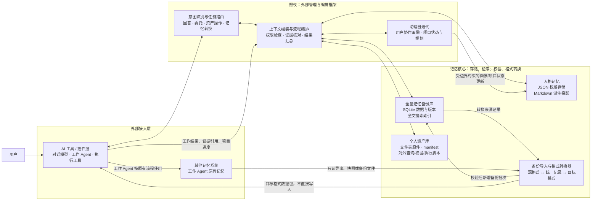
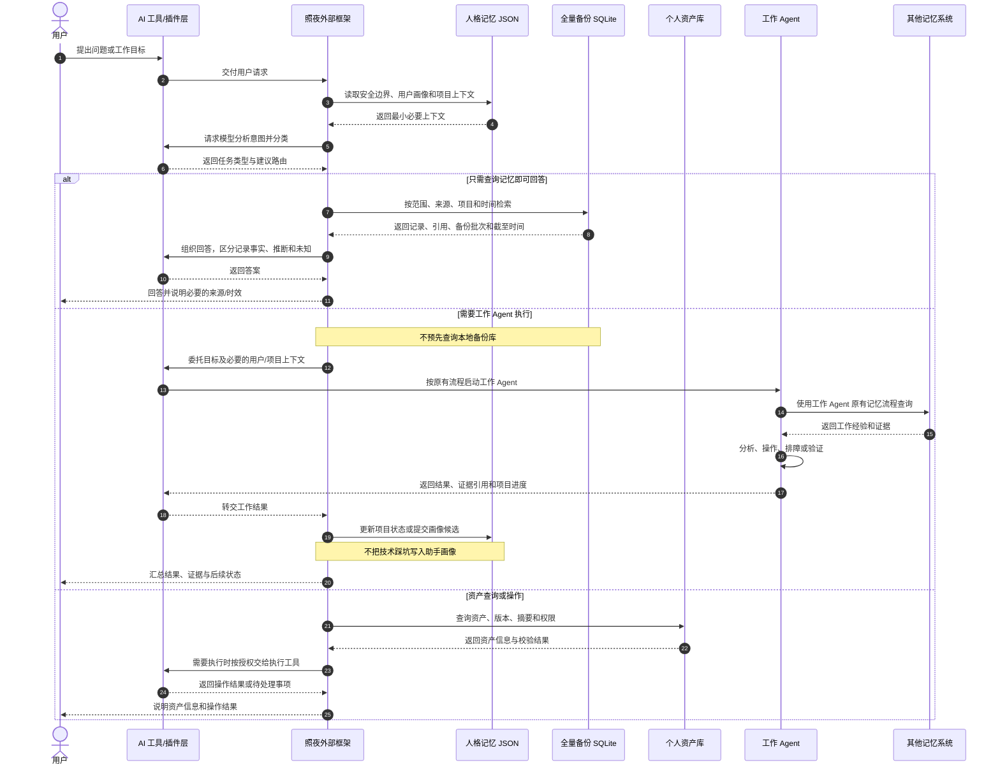

# 记忆核心架构总结

> **状态**：当前架构总结（2026-10-28）  
> **项目定位**：照夜是面向个人工作场景的外部管理与编排框架。它连接 AI 工具/插件、助手人格数据、其他记忆系统的只读备份，以及个人资产；不取代工作 Agent 使用的记忆系统。

## 1. 架构总览



图中的“转换器”负责结构与格式映射；外部框架决定何时转换、转换到哪里以及是否交给 AI 工具或工作 Agent 后续处理。照夜生成目标格式数据包，不直接写入目标记忆系统。

## 2. 记忆核心的三个数据域

三类数据各自有权威来源、接口、权限和生命周期。跨域协作只传递必要的 ID、证据引用和任务上下文，不把一种数据域的摘要伪装成另一域的事实。

| 数据域 | 存储格式 | 职责与边界 |
|---|---|---|
| 助手人格记忆 | JSON；Markdown 为投影 | 保存照夜作为用户助理的行为边界、协作画像、性格画像、项目连续性信息。画像和项目状态可在约束下迭代。 |
| 全量记忆备份库 | SQLite | 保存从其他记忆系统取得并转换的备份数据及版本，供照夜按需查询，也作为跨记忆系统格式转换的来源。不是工作 Agent 的在线记忆系统。 |
| 个人资产库 | 文件夹、manifest、对外脚本 | 保存 skill、文档、代码包等资产原件，提供列举、检索、校验、导出及按授权执行接口。 |

### 2.1 助手人格记忆的内部划分

人格 JSON 至少拆分以下内容，避免把安全边界、用户偏好和工作知识混在一起：

- **安全内核 `safety_kernel`**：少量稳定约束，例如不擅自主张、不主动修改用户资产或偏好。只有用户明确提出修改时才进入更新流程；模型推断、备份导入和工作 Agent 结果都不能自动改写它。
- **用户协作画像 `user_profile`**：用户明确表达或有充分对话依据的工作偏好、沟通习惯和协作方式。可自我迭代，保留来源、证据、置信度、版本和更新时间。
- **助手性格画像 `character_profile`**：照夜自己的表达风格、性格倾向和协作方式。允许在安全内核约束下迭代；不确定或敏感的变化可进入待确认状态。
- **项目状态与规划 `project_state`**：项目目标、已确认决策、当前进度、里程碑、风险、阻塞项和下一步。可依据用户对话及工作 Agent 返回的结果更新，并保留来源与时间。
- **连续性摘要 `continuity_memory`**：精选的共同经历，用于自然衔接对话。它是摘要，不替代全量备份记录作为工作事实证据。

**不进入助手人格自迭代的内容**：技术踩坑、排障步骤、命令、环境差异、代码经验和工作 Agent 的操作习惯。这些由工作 Agent 在其原有记忆系统中管理。照夜可接收其任务结果和项目进度，但不把工作经验自动沉淀为助手画像。

## 3. 任务路由与记忆查询时序

首要决策是判断用户要“基于已有记录回答”，还是要“委托执行”。工作执行路径直接由工作 Agent 按原流程查询原记忆系统；照夜不先查本地备份，避免同一任务重复检索。



### 路由规则

1. **记忆问答**：用户只问历史事实、以往经验或已有记录，且本地备份足以回答时，由照夜查询 SQLite。答案附来源引用、备份批次、截至时间及完整性状态。
2. **工作委托**：用户要求检查、开发、安装、排障、运行或验证时，直接委托工作 Agent。Agent 按其原流程访问原记忆系统；照夜不重复查备份。
3. **资产操作**：先查个人资产库并校验版本、摘要、来源和权限；查到资产不等于授权执行，执行按用户当前请求和既定权限策略处理。
4. **确有上下文缺口时**：若 Agent 执行过程中明确缺少某条照夜备份信息，框架才按需补查并把带引用的最小必要信息交给 Agent，不做默认双重检索。
5. **混合或不确定请求**：以主要目标分流。目标是完成工作时走工作 Agent；目标是了解历史时走本地记忆查询。必要时先回答历史部分，再按请求委托执行，但不让两条路径默认各查一遍。

## 4. 备份只读与跨系统转换

“备份只读”指助手查询和转换时不修改既有备份内容，也不把照夜的整理结果回写源记忆系统。备份导入流程可以向 SQLite **新增一个经过校验的导入批次/版本**，但不应静默覆盖旧快照或手工改写源记录。

```text
其他记忆系统
    └─只读导出 / 快照 / 备份文件
        → 照夜导入适配器
            → 校验与格式转换
                → SQLite 新备份批次 + 搜索索引
```

跨系统迁移时，数据流为：

```text
SQLite 备份记录 → 目标格式转换器 → 可导入数据包 → AI 工具/工作 Agent 原有导入流程
```

边界如下：

- 允许读取授权的备份文件或只读导出，并将其转换、校验、保存为本地备份版本。
- 允许把备份内容转换为其他记忆系统可识别的格式；转换器负责字段/结构映射，不执行语义蒸馏或事实裁决。
- 不调用其他记忆系统的在线查询、编辑、删除、写入或管理功能。
- 不由照夜直接写入目标系统。目标系统导入由对应工具或工作 Agent 按原有流程完成，并遵循其权限和确认规则。
- 每条备份记录保留来源系统、源记录 ID、来源范围、源更新时间、导出批次、转换器版本、内容摘要和可见/删除状态。
- 备份必须显示来源、完整性和截至时间。部分导入或失败批次不能冒充完整快照。

## 5. 模块职责与接口边界

| 模块 | 负责 | 不负责 |
|---|---|---|
| AI 工具/插件层 | 提供模型推理、对话、工作 Agent、执行器等能力；返回结构化结果 | 决定照夜的数据权限边界；将模型输出自动视为事实 |
| 外部框架 | 识别目标、路由任务、选择查询范围、组织上下文、校验证据、汇总结果、管理授权和项目状态 | 实现底层记忆数据库；把工作 Agent 技术经验写入助手人格 |
| 人格记忆存储 | 校验并保存人格 JSON；生成 Markdown 投影；提供读取与受控更新接口 | 自主决定画像是否应变化；让模型绕过安全内核直接改写 |
| SQLite 备份库 | 保存导入版本、查询记录、维护索引和来源信息；提供只读查询与格式转换数据接口 | 接管原记忆系统；默认对工作任务做预检索；向任何系统写回 |
| 导入/转换适配器 | 解析源格式、映射数据结构、校验转换结果、生成目标格式数据包 | 语义分析、经验判断、决定记忆取舍或直接操作目标系统 |
| 个人资产库及脚本 | 管理文件原件与 manifest，查询、校验、导出；在授权边界内提供执行入口 | 因资产被检索到就默认安装或运行 |
| 工作 Agent | 按原有流程完成受托工作并查询自己的记忆系统；返回结果和证据 | 修改照夜安全内核或未经框架确认就改变用户画像 |
| 其他记忆系统 | 继续作为工作 Agent 的原记忆服务；按授权提供备份/导出 | 被照夜接管或由照夜后台写入 |

## 6. 备份搜索原则

全量备份内容完整保存；热度只优化检索顺序，不删除或隐藏冷数据。查询先按权限、来源、Agent、项目和时间过滤，再结合全文相关度、时效、显式反馈和使用热度排序。热层命中不足时回退全量范围，并显示备份覆盖时间和完整性。

SQLite FTS5 可作为全文索引实现；热度数据和搜索索引是辅助数据，不是独立事实库。任何排序结果都应能回溯到备份记录与源记录引用。

## 7. 核心不变量

1. **三域分离**：人格记忆、全量备份、个人资产有不同的权威存储和权限，不能互相冒充事实来源。
2. **一任务一检索责任方**：记忆问答由照夜查本地备份；工作执行由 Agent 按原流程查原记忆系统。仅在明确缺口时补查。
3. **人格迭代有边界**：用户协作画像、助手性格画像和项目状态可迭代；安全内核需用户明确提出修改；工作踩坑不进入助手人格。
4. **备份不写回**：转换只生成本地版本或目标格式数据包；源系统和目标系统由其自身工具/工作 Agent 流程操作。
5. **来源可追溯**：答案与更新保留记录引用、来源、时间和置信状态；过期、部分或不可见数据显式降级。
6. **资产执行需授权**：检索资产、校验资产与执行资产是不同步骤。

## 8. 关联设计

本文件是便于理解和评审的架构总结。更完整的存储字段、恢复、安全和实施阶段见[外部管理框架与记忆核心设计](外部管理框架与记忆核心设计.md)。发生冲突时，以较新的用户确认和项目当前设计基线为准。
